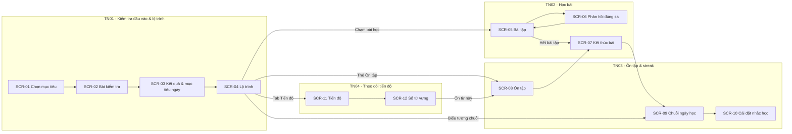

# Đề 3 · App học tiếng Anh

> **Mã:** DE03 · **Độ khó:** 3/8 · **Vai trò:** 1 (người học) · **Nền tảng:** App iOS / Android

App giúp người Việt tự học tiếng Anh bằng các bài ngắn mỗi ngày: kiểm tra đầu vào để xếp trình độ, học theo lộ trình, ôn lại từ sắp quên và theo dõi tiến độ. Đề gồm 4 tính năng; mỗi tính năng có 1 PRD và 1 SRS riêng.

## Tính năng

| **Mã** | **Tính năng** | **Phạm vi** | **PRD** | **SRS** |
| --- | --- | --- | --- | --- |
| TN01 | Kiểm tra đầu vào & lộ trình | Chọn mục tiêu, bài kiểm tra xếp trình độ, lộ trình đề xuất, mục tiêu học mỗi ngày | [PRD](docs/TN01-kiem-tra-dau-vao-lo-trinh/PRD.md) | [SRS](docs/TN01-kiem-tra-dau-vao-lo-trinh/SRS.md) |
| TN02 | Học bài | Bài học 5 phút với các dạng bài từ vựng, nghe, nói; phản hồi đúng sai tức thì | [PRD](docs/TN02-hoc-bai/PRD.md) | [SRS](docs/TN02-hoc-bai/SRS.md) |
| TN03 | Ôn tập & streak | Ôn từ theo lặp lại ngắt quãng, chuỗi ngày học, nhắc học | [PRD](docs/TN03-on-tap-streak/PRD.md) | [SRS](docs/TN03-on-tap-streak/SRS.md) |
| TN04 | Theo dõi tiến độ | Thời gian học theo tuần, tiến độ trình độ, sổ từ vựng | [PRD](docs/TN04-theo-doi-tien-do/PRD.md) | [SRS](docs/TN04-theo-doi-tien-do/SRS.md) |

Thứ tự làm gợi ý: TN01 → TN02 → TN03 → TN04.

## Bản đồ tính năng và màn hình



## Bối cảnh chung

Người đi làm và sinh viên muốn cải thiện tiếng Anh nhưng không có thời gian cố định. Họ thường tải app, học vài ngày rồi bỏ vì bài quá dễ hoặc quá khó, vì quên mở app, và vì không thấy mình tiến bộ.

| **Nhóm người dùng** | **Nhu cầu chính** |
| --- | --- |
| Người mất gốc | Bắt đầu lại từ đầu mà không thấy xấu hổ |
| Người đi làm cần giao tiếp công việc | Học đúng trình độ, tranh thủ 5–10 phút mỗi ngày |
| Sinh viên ôn thi | Tăng vốn từ, luyện nghe đều đặn |

Ngoài phạm vi cả đề: lớp học trực tuyến với giáo viên, luyện thi theo đề (IELTS, TOEIC), bảng xếp hạng và kết bạn, gói trả phí và thanh toán, soạn nội dung bài học (CMS).

## Quy ước dùng chung

- Trình độ theo khung CEFR rút gọn: A1, A2, B1, B2.
- Đăng ký, đăng nhập dùng luồng tài khoản chuẩn (email, Google, Apple), không mô tả trong bộ tài liệu này. Cho học thử không cần tài khoản đến hết bài kiểm tra đầu vào.
- Mã BR, MSG, UC đánh số liên tục trong cả đề: TN01 dùng BR-01–10, MSG-01–08; TN02 dùng BR-11–22, MSG-09–18; TN03 dùng BR-23–32, MSG-19–26; TN04 dùng BR-33–39, MSG-27–30.
- Điều hướng: tab bar Học (lộ trình) · Ôn tập · Tiến độ · Hồ sơ.

## Danh sách màn hình

| **Mã** | **Màn hình** | **Mô tả chi tiết ở** |
| --- | --- | --- |
| SCR-01 | Chọn mục tiêu | SRS TN01 |
| SCR-02 | Bài kiểm tra đầu vào | SRS TN01 |
| SCR-03 | Kết quả & mục tiêu ngày | SRS TN01 |
| SCR-04 | Lộ trình | SRS TN01 |
| SCR-05 | Bài tập | SRS TN02 |
| SCR-06 | Phản hồi đúng sai | SRS TN02 |
| SCR-07 | Kết thúc bài | SRS TN02 |
| SCR-08 | Ôn tập | SRS TN03 |
| SCR-09 | Chuỗi ngày học | SRS TN03 |
| SCR-10 | Cài đặt nhắc học | SRS TN03 |
| SCR-11 | Tiến độ | SRS TN04 |
| SCR-12 | Sổ từ vựng | SRS TN04 |

## Cấu trúc repo

```text
de03-hoc-tieng-anh/
├── README.md
└── docs/
    ├── TN01-kiem-tra-dau-vao-lo-trinh/   PRD.md · SRS.md
    ├── TN02-hoc-bai/                     PRD.md · SRS.md
    ├── TN03-on-tap-streak/               PRD.md · SRS.md
    └── TN04-theo-doi-tien-do/            PRD.md · SRS.md
```

## Cách dùng bộ tài liệu

1. Đọc README để nắm phạm vi cả app và danh sách màn hình.
2. Với mỗi tính năng: đọc PRD (vì sao làm, cho ai, đo bằng gì), rồi SRS (quy tắc, trạng thái, use case, màn hình, thông báo).
3. Thiết kế màn hình theo đúng mã SCR, mã MSG trong SRS để dễ đối chiếu khi review.
4. Sơ đồ viết bằng Mermaid, xem trực tiếp trên GitHub hoặc trình xem Markdown có hỗ trợ Mermaid.
