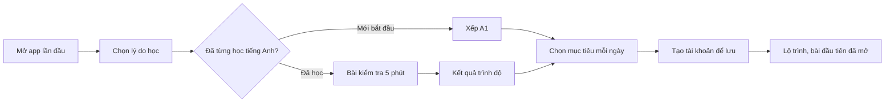

> **Mã:** DE03-TN01-PRD · **Trạng thái:** nháp · **Người viết:** Design (mock) · **SRS:** [SRS.md](SRS.md)

# PRD Kiểm tra đầu vào và lộ trình (App học tiếng Anh)

> **Bản mock.** Con số đánh dấu `[giả định]` dùng để dựng flow, cần PO xác nhận trước khi dùng.

## 1. Bối cảnh và vấn đề

### 1.1 Bối cảnh

Người dùng mới tải app với trình độ rất khác nhau: có người mất gốc, có người đã đọc hiểu tài liệu công việc. Vài phút đầu tiên quyết định họ có ở lại hay không. Tính năng này lo từ lúc mở app lần đầu đến khi người học đứng trước bài học đầu tiên phù hợp với mình.

### 1.2 Vấn đề

| **Vấn đề** | **Hệ quả** |
| --- | --- |
| Ai cũng bắt đầu từ bài 1 | Người có nền thấy chán, bỏ app trong ngày đầu |
| Bài kiểm tra dài, giống đi thi | Bỏ giữa chừng, chưa kịp học bài nào |
| Kết quả chỉ là một điểm số | Không hiểu mình ở đâu, sẽ học gì |
| Bắt đăng ký tài khoản trước khi thấy giá trị | Rời app ở màn đăng ký |
| Không đặt mục tiêu học mỗi ngày | Không có cam kết, dễ bỏ |

### 1.3 Mục tiêu

- ≥ 70% người dùng mới hoàn thành onboarding (đến màn lộ trình) `[giả định]`.
- Thời gian từ mở app đến bài học đầu tiên ≤ 6 phút `[giả định]`.
- ≥ 60% người hoàn thành onboarding học xong bài đầu tiên trong cùng ngày `[giả định]`.

## 2. Người dùng

| **Nhóm** | **Nhu cầu với tính năng này** |
| --- | --- |
| Người mất gốc | Bỏ qua kiểm tra, bắt đầu từ đầu mà không bị đánh giá |
| Người đi làm cần giao tiếp công việc | Được xếp đúng trình độ, không học lại thứ đã biết |
| Sinh viên ôn thi | Biết trình độ hiện tại và còn bao xa tới mục tiêu |

## 3. Phạm vi

### 3.1 Trong phạm vi (MVP)

- Chọn lý do học (giao tiếp, công việc, du lịch, thi cử).
- Chọn "Tôi mới bắt đầu" hoặc làm bài kiểm tra xếp trình độ.
- Bài kiểm tra thích ứng, tối đa 20 câu, khoảng 5 phút.
- Kết quả: trình độ (A1–B2), giải thích ngắn, lộ trình đề xuất.
- Chọn mục tiêu học mỗi ngày: 5, 10, 15, 20 phút.
- Màn lộ trình: các chặng, bài học, trạng thái khoá, mở, hoàn thành.
- Làm lại bài kiểm tra sau này.

### 3.2 Ngoài phạm vi

- Kiểm tra kỹ năng nói và viết trong bài đầu vào.
- Lộ trình riêng theo ngành nghề → phase sau.
- Tự chọn thứ tự học tuỳ ý giữa các chặng.
- Chứng nhận trình độ.

## 4. Nguyên tắc sản phẩm

### 4.1 Giá trị trước, tài khoản sau

Người dùng làm kiểm tra và xem kết quả trước, đến lúc lưu lộ trình mới được mời tạo tài khoản.

### 4.2 Kiểm tra không phải đi thi

Bài ngắn, không đếm ngược từng câu, có nút "Tôi không biết". Không hiện đúng sai sau từng câu để tránh nản.

### 4.3 Kết quả là điểm xuất phát

Màn kết quả nói người học đã làm được gì và sẽ học gì tiếp, không nhấn vào chỗ yếu.

### 4.4 Luôn có đường lui

Bỏ qua kiểm tra được, đổi trình độ được, làm lại kiểm tra được.

## 5. Quy tắc nghiệp vụ

| **Quy tắc** | **Giá trị** `[giả định]` |
| --- | --- |
| Trình độ | A1, A2, B1, B2 |
| Bài kiểm tra | Thích ứng; bắt đầu ở A2; tối đa 20 câu; dừng sớm khi đã xác định được trình độ (chạm bậc cao nhất hoặc thấp nhất, hoặc dao động quanh một bậc); hết 20 câu thì xếp ở bậc cao nhất đạt từ 50% đúng |
| Dạng câu | Chọn nghĩa từ, điền từ vào câu, nghe chọn đáp án, đọc hiểu ngắn |
| "Tôi không biết" | Tính là sai, không phạt thêm |
| Bỏ dở kiểm tra | Giữ tiến trình 24 giờ để làm tiếp |
| Làm lại kiểm tra | Tối đa 1 lần mỗi 30 ngày |
| Mục tiêu ngày | 5, 10 (mặc định), 15, 20 phút |
| Mở bài học | Hoàn thành bài trước thì mở bài sau; các chặng dưới trình độ được đánh dấu "Đã vượt qua" |

- Các giá trị trên là **cấu hình**, không cố định trong code.

## 6. Luồng trải nghiệm

| **Bước** | **Giai đoạn** | **Trải nghiệm** | **Đầu ra** |
| --- | --- | --- | --- |
| 1 | Chào mừng | Một màn giới thiệu ngắn, nút Bắt đầu | Vào onboarding |
| 2 | Lý do học | Chọn 1 trong 4 lý do | Lý do học |
| 3 | Điểm xuất phát | "Tôi mới bắt đầu" hoặc "Kiểm tra trình độ" | Nhánh onboarding |
| 4 | Kiểm tra | Tối đa 20 câu, thanh tiến trình, nút "Tôi không biết" | Bài làm |
| 5 | Kết quả | Trình độ, mô tả ngắn, số chặng sẽ học | Trình độ |
| 6 | Mục tiêu ngày | Chọn 5–20 phút, bật nhắc học | Mục tiêu ngày |
| 7 | Lưu | Mời tạo tài khoản; có thể để sau | Tài khoản hoặc hồ sơ tạm |
| 8 | Lộ trình | Chặng hiện tại mở sẵn, bài đầu tiên nổi bật | Sẵn sàng học |

## 7. Use Cases, User Stories và Acceptance Criteria

### UC1. Onboarding

#### US1.1 Chọn lý do học và điểm xuất phát

User Story: Là người dùng mới, tôi muốn nói cho app biết tôi học để làm gì và đang ở đâu để được học đúng thứ mình cần.

AC01: Chọn 1 lý do học; có thể đổi sau trong Hồ sơ.

AC02: Hai lựa chọn rõ ràng: "Tôi mới bắt đầu" và "Kiểm tra trình độ", kèm thời lượng ước tính.

AC03: Chọn "Tôi mới bắt đầu" → xếp A1, bỏ qua bài kiểm tra.

#### US1.2 Làm bài kiểm tra

User Story: Là người đã có nền, tôi muốn làm một bài kiểm tra ngắn để không phải học lại từ đầu.

AC01: Mỗi màn một câu; có thanh tiến trình; không đếm ngược từng câu.

AC02: Mỗi câu có nút "Tôi không biết".

AC03: Không hiện đúng sai sau từng câu.

AC04: Thoát giữa chừng → hỏi xác nhận; tiến trình được giữ 24 giờ.

AC05: Câu nghe không phát được âm thanh → cho bỏ qua câu đó mà không tính sai.

#### US1.3 Xem kết quả và đặt mục tiêu

User Story: Là người học, tôi muốn hiểu trình độ của mình và đặt mục tiêu học mỗi ngày để có kỳ vọng đúng và cam kết vừa sức.

AC01: Kết quả hiện trình độ, một câu mô tả "Bạn có thể…", và số chặng trong lộ trình.

AC02: Cho chọn bắt đầu ở trình độ thấp hơn một bậc nếu thấy quá sức.

AC03: Chọn mục tiêu ngày, mặc định 10 phút; mỗi mức kèm mô tả ngắn.

AC04: Mời bật nhắc học ngay sau khi chọn mục tiêu; từ chối vẫn tiếp tục được.

### UC2. Lộ trình

#### US2.1 Xem lộ trình

User Story: Là người học, tôi muốn thấy mình đang ở đâu và sắp học gì.

AC01: Lộ trình chia theo chặng; mỗi chặng có tên chủ đề và danh sách bài.

AC02: Bài có 3 trạng thái: khoá, đang mở, đã hoàn thành.

AC03: Mở app là cuộn tới bài đang mở tiếp theo.

AC04: Các chặng dưới trình độ được xếp hiện "Đã vượt qua", vẫn vào học lại được.

#### US2.2 Đổi trình độ

User Story: Là người học, tôi muốn làm lại bài kiểm tra để đổi trình độ khi lộ trình không còn vừa sức.

AC01: Làm lại bài kiểm tra từ Hồ sơ; nếu chưa đủ 30 ngày thì báo ngày được làm lại.

AC02: Trình độ mới cao hơn → mở khoá các chặng tương ứng; không xoá tiến độ đã học.

## 8. Chỉ số theo dõi `[giả định]`

| **Chỉ số** | **Định nghĩa** | **Mục tiêu MVP** |
| --- | --- | --- |
| Tỉ lệ hoàn thành onboarding | Người dùng tới màn lộ trình / người dùng mở app lần đầu | ≥ 70% |
| Tỉ lệ hoàn thành kiểm tra | Người hoàn thành / người bắt đầu kiểm tra | ≥ 80% |
| Tỉ lệ chọn kiểm tra | Người chọn kiểm tra / người tới bước điểm xuất phát | Theo dõi |
| Thời gian tới bài đầu tiên | Từ mở app đến bắt đầu bài học đầu tiên | ≤ 6 phút (trung vị) |
| Tỉ lệ học bài đầu trong ngày | Người học xong bài 1 trong ngày đầu / người hoàn thành onboarding | ≥ 60% |
| Tỉ lệ hạ trình độ | Người chọn bắt đầu thấp hơn / người có kết quả | Theo dõi; cao là dấu hiệu xếp quá cao |

## 9. Phụ thuộc và rủi ro

| **Mục** | **Mô tả** | **Hướng xử lý** |
| --- | --- | --- |
| Ngân hàng câu hỏi | Cần câu hỏi đã gán trình độ, đủ số lượng để không lặp | Đội nội dung cung cấp; tối thiểu 40 câu mỗi trình độ |
| Độ chính xác xếp trình độ | Xếp sai làm bài quá dễ hoặc quá khó | Cho hạ một bậc; theo dõi tỉ lệ đúng ở 3 bài đầu |
| Âm thanh | Câu nghe không phát được khi mạng yếu hoặc tắt tiếng | Tải trước âm thanh; cho bỏ qua câu nghe |
| Rời app ở màn tài khoản | Người dùng không muốn đăng ký | Cho "Để sau", lưu hồ sơ tạm trên máy |
| Quyền thông báo | Từ chối quyền thì mất kênh nhắc học | Giải thích lợi ích trước khi hệ điều hành hỏi quyền |

## 10. Câu hỏi mở

> Câu nào đã có giá trị ở mục 5 thì giá trị đó là **tạm chốt** `[giả định]` để dựng flow. Câu hỏi vẫn để mở cho đến khi PO xác nhận.

- Hồ sơ tạm (chưa có tài khoản) được giữ bao lâu, và có giới hạn số bài học không? → **Đã chốt:** Giữ 2 năm trên máy, không giới hạn số bài học.
- Có cho người học tự chọn trình độ mà không cần kiểm tra không?
- Lý do học có làm thay đổi nội dung lộ trình ở MVP không, hay chỉ ghi nhận? → **Đã chốt:** Không. Chỉ ghi nhận ở MVP.
- Khoảng cách làm lại kiểm tra 30 ngày có phù hợp không?
