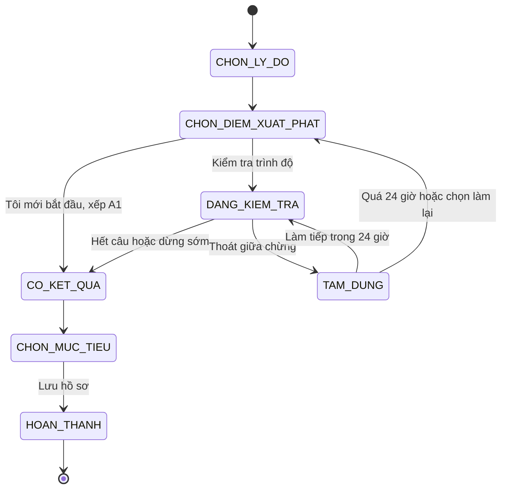
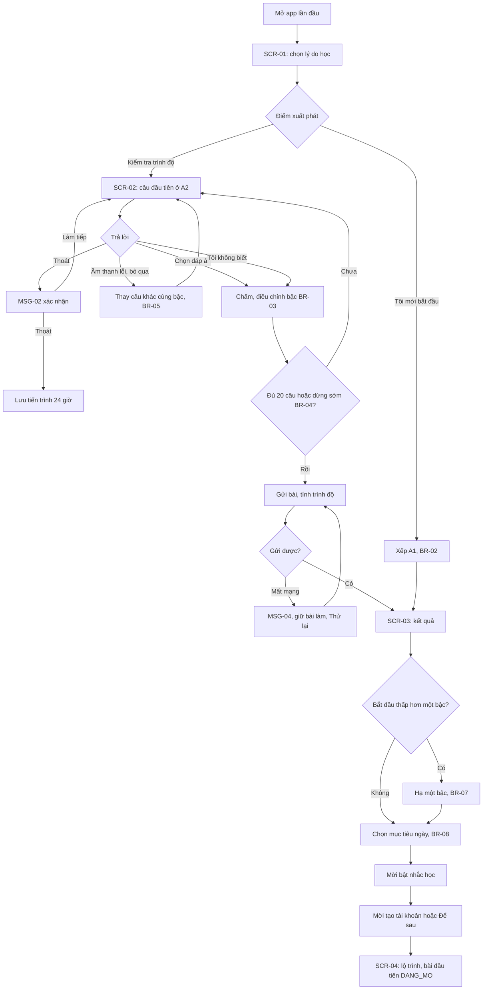
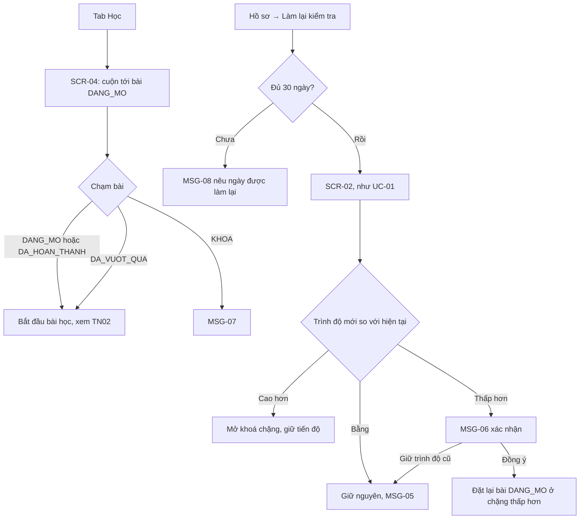
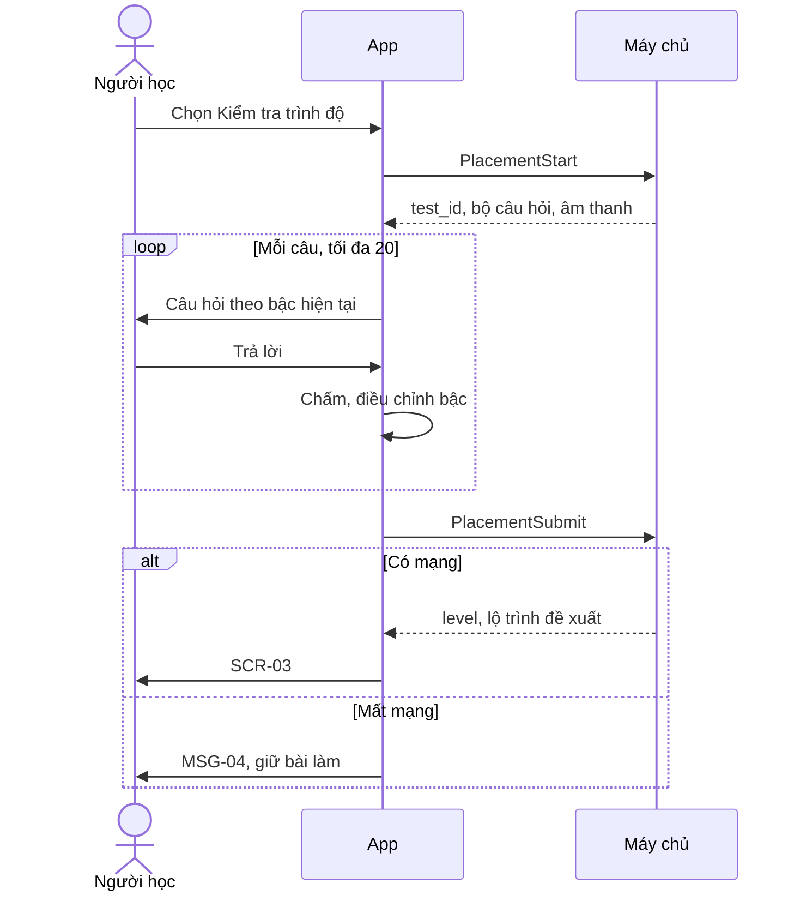

> **Mã:** DE03-TN01-SRS · **Trạng thái:** nháp · **Người viết:** Design (mock) · **PRD:** [PRD.md](PRD.md)

# UC-DE03-01 - Kiểm tra đầu vào và lộ trình

> **Bản mock.** Giá trị `[giả định]` cần BA xác nhận. Màn bài học xem [SRS TN02](../TN02-hoc-bai/SRS.md); nhắc học xem [SRS TN03](../TN03-on-tap-streak/SRS.md).

## 1. Tổng quan

| **Mục** | **Nội dung** |
| --- | --- |
| Mục tiêu | Xếp người học mới vào đúng trình độ, đặt mục tiêu học mỗi ngày và đưa họ tới bài học đầu tiên |
| Actor | Người học · Hệ thống (app) · Máy chủ nội dung |
| Phạm vi | Onboarding, bài kiểm tra đầu vào, kết quả, mục tiêu ngày, màn lộ trình, làm lại kiểm tra |
| Ngoài phạm vi | Kiểm tra nói và viết, lộ trình theo ngành, chứng nhận |
| Nền tảng | App iOS / Android `[giả định]` |
| Figma | `[chưa có]` |

## 2. User Story

| **ID** | **As a** | **I want** | **So that** |
| --- | --- | --- | --- |
| US-01 | Người mới bắt đầu | Bỏ qua kiểm tra, học từ đầu | Không bị áp lực |
| US-02 | Người đã có nền | Làm bài kiểm tra ngắn | Không học lại thứ đã biết |
| US-03 | Người học | Hiểu trình độ của mình và sẽ học gì | Có kỳ vọng đúng |
| US-04 | Người học | Đặt mục tiêu học mỗi ngày | Có cam kết vừa sức |
| US-05 | Người học | Xem lộ trình và bài tiếp theo | Biết bắt đầu từ đâu |

## 3. Business Rules

| **Mã** | **Quy tắc** |
| --- | --- |
| BR-01 | **Trình độ** gồm A1, A2, B1, B2. Mỗi trình độ gồm nhiều chặng, mỗi chặng 5–8 bài học `[giả định]` |
| BR-02 | Chọn "Tôi mới bắt đầu" → xếp A1, không làm kiểm tra |
| BR-03 | **Bài kiểm tra thích ứng**: bắt đầu bằng câu A2. Trả lời đúng 2 câu liên tiếp → lên một bậc; sai 2 câu liên tiếp → xuống một bậc. Tối đa 20 câu `[giả định]` |
| BR-04 | **Dừng sớm**: từ câu thứ 8, nếu 6 câu gần nhất cùng một bậc với tỉ lệ đúng 50–80% thì kết thúc và xếp ở bậc đó `[giả định]` |
| BR-05 | "Tôi không biết" tính là sai. Câu nghe bị bỏ qua vì lỗi âm thanh không tính vào kết quả và được thay bằng câu khác cùng bậc |
| BR-06 | **Bỏ dở**: lưu tiến trình 24 giờ; quay lại trong thời gian này được hỏi làm tiếp hay làm lại (MSG-03). Quá 24 giờ thì bắt đầu lại |
| BR-07 | **Kết quả**: trình độ xếp được; cho chọn "Bắt đầu thấp hơn một bậc" (không áp dụng khi kết quả là A1) |
| BR-08 | **Mục tiêu ngày**: 5, 10, 15, 20 phút; mặc định 10; đổi được trong Hồ sơ, áp dụng từ ngày hôm sau |
| BR-09 | **Mở khoá**: trong một chặng, hoàn thành bài trước thì mở bài sau. Chặng thuộc trình độ thấp hơn trình độ xếp được đánh dấu `DA_VUOT_QUA` và vẫn vào học được. Chặng cao hơn bị khoá cho tới khi xong chặng trước |
| BR-10 | **Làm lại kiểm tra**: tối đa 1 lần mỗi 30 ngày. Trình độ mới cao hơn → mở khoá chặng tương ứng; thấp hơn → hỏi xác nhận trước khi áp dụng; tiến độ đã học luôn được giữ `[giả định]` |

## 4. Trạng thái

### 4.1 Trạng thái onboarding

### 4.2 Trạng thái bài học trên lộ trình

| **Trạng thái** | **Điều kiện** | **Hiển thị** |
| --- | --- | --- |
| `KHOA` | Chưa xong bài trước, hoặc chặng chưa mở | Biểu tượng khoá, mờ; chạm hiện MSG-07 |
| `DANG_MO` | Bài tiếp theo cần học | Nổi bật, có nút "Bắt đầu" |
| `DA_HOAN_THANH` | Đã học xong ít nhất 1 lần | Dấu tích; chạm để học lại |
| `DA_VUOT_QUA` | Thuộc chặng dưới trình độ xếp được, chưa học | Nhãn "Đã vượt qua"; chạm để học |

## 5. Use Case

### UC-01 Onboarding và kiểm tra đầu vào

| **Mục** | **Nội dung** |
| --- | --- |
| Tiền điều kiện | Mở app lần đầu, hoặc hồ sơ chưa có trình độ |
| Hậu điều kiện thành công | Hồ sơ có lý do học, trình độ, mục tiêu ngày; lộ trình mở ở chặng phù hợp |
| Hậu điều kiện thất bại | Hồ sơ chưa có trình độ; tiến trình kiểm tra được giữ theo BR-06 |

**Luồng chính**

| **Bước** | **Actor** | **Mô tả** |
| --- | --- | --- |
| 1 | Người học | Mở app lần đầu, bấm Bắt đầu |
| 2 | Hệ thống | Mở **SCR-01**: chọn lý do học, rồi chọn điểm xuất phát |
| 3 | Người học | Chọn "Kiểm tra trình độ" |
| 4 | Hệ thống | Tải bộ câu hỏi (\[PlacementStart\]), mở **SCR-02** với câu đầu tiên ở bậc A2 |
| 5 | Người học | Trả lời từng câu hoặc bấm "Tôi không biết" |
| 6 | Hệ thống | Sau mỗi câu: ghi kết quả, chọn câu tiếp theo theo BR-03; kiểm tra điều kiện dừng (BR-04) |
| 7 | Hệ thống | Kết thúc: gửi bài (\[PlacementSubmit\]), nhận trình độ, mở **SCR-03** |
| 8 | Người học | Xem kết quả, chọn mục tiêu ngày, bấm Tiếp tục |
| 9 | Hệ thống | Mời bật nhắc học, mời tạo tài khoản; lưu hồ sơ (\[ProfileSave\]) |
| 10 | Hệ thống | Mở **SCR-04**, cuộn tới bài `DANG_MO` đầu tiên |

**Luồng thay thế**

| **Mã** | **Điều kiện** | **Xử lý** |
| --- | --- | --- |
| A1 | Chọn "Tôi mới bắt đầu" | Bỏ bước 4–7; **SCR-03** hiện kết quả A1 với lời chào cho người mới |
| A2 | Chọn "Bắt đầu thấp hơn một bậc" | Hạ một bậc trước khi lưu (BR-07) |
| A3 | Thoát giữa bài kiểm tra | MSG-02; xác nhận thì lưu tiến trình (BR-06), về **SCR-01** |
| A4 | Quay lại trong 24 giờ | MSG-03: "Làm tiếp" hoặc "Làm lại từ đầu" |
| A5 | Chọn "Để sau" ở bước tạo tài khoản | Lưu hồ sơ tạm trên máy; nhắc tạo tài khoản sau bài học đầu tiên |
| A6 | Từ chối quyền thông báo | Tiếp tục bình thường; nhắc học tắt |

**Luồng lỗi**

| **Mã** | **Điều kiện** | **Xử lý** |
| --- | --- | --- |
| E1 | Không tải được bộ câu hỏi | MSG-01, nút Thử lại; cho chọn "Tôi mới bắt đầu" thay thế |
| E2 | Âm thanh câu nghe không phát được | Nút "Không nghe được" → bỏ qua câu theo BR-05 |
| E3 | Mất mạng khi gửi bài | MSG-04; giữ bài làm trên máy, tự gửi lại khi có mạng |

### UC-02 Xem lộ trình và làm lại kiểm tra

| **Mục** | **Nội dung** |
| --- | --- |
| Tiền điều kiện | Hồ sơ đã có trình độ |
| Hậu điều kiện | Người học thấy bài tiếp theo; trình độ được cập nhật nếu làm lại kiểm tra |

**Luồng chính**

| **Bước** | **Actor** | **Mô tả** |
| --- | --- | --- |
| 1 | Người học | Mở tab Học |
| 2 | Hệ thống | Tải lộ trình (\[PathGet\]), mở **SCR-04**, cuộn tới bài `DANG_MO` |
| 3 | Người học | Chạm bài `DANG_MO` |
| 4 | Hệ thống | Mở bài học (SRS TN02) |

**Luồng thay thế**

| **Mã** | **Điều kiện** | **Xử lý** |
| --- | --- | --- |
| A1 | Chạm bài `KHOA` | MSG-07 |
| A2 | Chạm bài `DA_HOAN_THANH` hoặc `DA_VUOT_QUA` | Mở bài để học; không đổi thứ tự mở khoá |
| A3 | Làm lại kiểm tra, chưa đủ 30 ngày | MSG-08 |
| A4 | Làm lại, trình độ cao hơn | Mở khoá chặng tương ứng (BR-10) |
| A5 | Làm lại, trình độ thấp hơn | MSG-06; người học chọn áp dụng hoặc giữ trình độ cũ |
| A6 | Mất mạng | Hiện lộ trình đã lưu gần nhất kèm ghi chú "Đang ngoại tuyến" |

## 6. Điểm vào

| **Điểm vào** | **Dẫn tới** | **Ghi chú** |
| --- | --- | --- |
| Mở app lần đầu | UC-01, **SCR-01** | |
| Mở app khi hồ sơ chưa có trình độ | UC-01 | Có tiến trình dở trong 24 giờ → MSG-03 |
| Tab Học | UC-02, **SCR-04** | Màn mặc định sau onboarding |
| Hồ sơ → Làm lại kiểm tra | UC-02 (A3–A5) | |
| Hồ sơ → Mục tiêu mỗi ngày | Chọn lại mục tiêu | BR-08 |

## 7. Mô tả màn hình

### SCR-01 Chọn mục tiêu

| **#** | **Thành phần** | **Loại** | **Bắt buộc** | **Validate / hành vi** |
| --- | --- | --- | --- | --- |
| 1 | Lý do học | Thẻ chọn 1 | Có | Giao tiếp hằng ngày, Công việc, Du lịch, Thi cử |
| 2 | Điểm xuất phát | Thẻ chọn 1 | Có | "Tôi mới bắt đầu" · "Kiểm tra trình độ (khoảng 5 phút)" |
| 3 | Nút Tiếp tục | Button | – | Disabled đến khi chọn xong bước hiện tại |
| 4 | Thanh bước | Progress | – | Vị trí trong onboarding |

### SCR-02 Bài kiểm tra đầu vào

| **#** | **Thành phần** | **Loại** | **Hành vi** |
| --- | --- | --- | --- |
| 1 | Thanh tiến trình | Progress | Theo số câu đã làm trên tối đa 20; không hiện số bậc |
| 2 | Nút thoát | Icon | MSG-02 |
| 3 | Câu hỏi | Text / audio | Dạng chọn nghĩa, điền từ, nghe, đọc hiểu; câu nghe có nút phát lại, không giới hạn số lần |
| 4 | Đáp án | Chọn 1 trong 4 | Chọn xong mới bật nút Tiếp |
| 5 | "Tôi không biết" | Button text | Sang câu tiếp, tính sai (BR-05) |
| 6 | "Không nghe được" | Button text | Chỉ ở câu nghe; bỏ qua câu (BR-05) |
| 7 | Nút Tiếp | Button | Không hiện đúng sai |

### SCR-03 Kết quả & mục tiêu ngày

| **#** | **Thành phần** | **Loại** | **Hành vi** |
| --- | --- | --- | --- |
| 1 | Trình độ | Tiêu đề lớn | "Trình độ của bạn: {A1–B2}" kèm tên dễ hiểu (Mới bắt đầu, Sơ cấp, Trung cấp, Trung cấp trên) |
| 2 | Mô tả | Text | Một câu "Bạn có thể…" theo trình độ |
| 3 | Lộ trình đề xuất | Card | Số chặng, số bài, thời gian ước tính theo mục tiêu ngày |
| 4 | "Bắt đầu thấp hơn một bậc" | Link | Ẩn khi kết quả là A1 |
| 5 | Mục tiêu ngày | Chọn 1 | 5 phút (Nhẹ nhàng), 10 phút (Đều đặn), 15 phút (Nghiêm túc), 20 phút (Quyết tâm) |
| 6 | Nút Tiếp tục | Button | Lưu và sang bước bật nhắc học |

### SCR-04 Lộ trình

| **#** | **Thành phần** | **Loại** | **Hành vi** |
| --- | --- | --- | --- |
| 1 | Header | Header | Trình độ hiện tại, biểu tượng chuỗi ngày học (mở **SCR-09**), tiến độ mục tiêu hôm nay |
| 2 | Chặng | Section | Tên chủ đề, "{x}/{y} bài", trạng thái chặng |
| 3 | Bài học | Node | Theo trạng thái mục 4.2; bài `DANG_MO` có nút "Bắt đầu" |
| 4 | Thẻ Ôn tập | Card | Số từ cần ôn hôm nay (SRS TN03) |
| 5 | Ghi chú ngoại tuyến | Banner | Hiện khi dùng dữ liệu đã lưu |

## 8. API

| **API** | **Request chính** | **Response chính** | **Timeout / retry** `[giả định]` |
| --- | --- | --- | --- |
| \[PlacementStart\] | reason | test_id, bộ câu hỏi đủ cho mọi nhánh, link âm thanh | 8s / 2 lần |
| \[PlacementSubmit\] | test_id, danh sách câu trả lời | level, mô tả, lộ trình đề xuất | 8s / tự gửi lại khi có mạng |
| \[ProfileSave\] | reason, level, daily_goal_minutes | profile_id | 5s / 2 lần |
| \[PathGet\] | profile_id | Chặng, bài, trạng thái từng bài | 5s / 1 lần; có cache |
| \[PlacementEligibility\] | profile_id | can_retake, next_date | 5s / 1 lần |

Việc chọn câu tiếp theo (BR-03) chạy trên app với bộ câu hỏi đã tải, để bài kiểm tra không phụ thuộc mạng ở từng câu.

**Map lỗi → thông báo** `[giả định]`

| **Nhóm lỗi** | **Message** |
| --- | --- |
| Không tải được bài kiểm tra (mất mạng, máy chủ lỗi) | MSG-01 |
| Gửi bài thất bại do mất kết nối | MSG-04, tự gửi lại khi có mạng |
| Chưa đủ điều kiện làm lại bài kiểm tra | MSG-08 |
| Mở bài chưa được mở khoá | MSG-07 |
| Lưu hồ sơ, mục tiêu thất bại | Thông báo lỗi chung của app (ngoài bộ MSG của SRS này), cho thử lại |

## 9. Danh sách thông báo

| **ID** | **Nơi hiện** | **Nội dung (VI)** |
| --- | --- | --- |
| MSG-01 | Màn lỗi | Không tải được bài kiểm tra. Vui lòng kiểm tra kết nối. \[Thử lại\] \[Tôi mới bắt đầu\] |
| MSG-02 | Popup | Thoát bài kiểm tra? Bạn có thể làm tiếp trong 24 giờ. \[Làm tiếp\] \[Thoát\] |
| MSG-03 | Popup | Bạn đang làm dở bài kiểm tra. \[Làm tiếp\] \[Làm lại từ đầu\] |
| MSG-04 | Màn lỗi | Chưa gửi được bài vì mất kết nối. Bài làm của bạn đã được lưu. \[Thử lại\] |
| MSG-05 | Toast | Trình độ của bạn vẫn là {trình độ} |
| MSG-06 | Popup | Kết quả lần này là {trình độ mới}, thấp hơn trình độ hiện tại. Bạn muốn học lại từ {trình độ mới}? Tiến độ đã học vẫn được giữ. \[Giữ {trình độ cũ}\] \[Học từ {trình độ mới}\] |
| MSG-07 | Toast | Hoàn thành bài trước để mở bài này |
| MSG-08 | Popup | Bạn có thể làm lại bài kiểm tra từ ngày {dd/mm/yyyy} |

Bản EN: `[chờ bổ sung]`.

## 10. Yêu cầu phi chức năng

| **Mục** | **Yêu cầu** `[giả định]` |
| --- | --- |
| Hiệu năng | Tải bộ câu hỏi ≤ 3 giây trên 4G; chuyển câu ≤ 200 ms |
| Offline | Bài kiểm tra chạy được khi mất mạng sau khi đã tải; lộ trình có bản lưu để xem ngoại tuyến |
| Âm thanh | Âm thanh câu nghe tải trước cùng bộ câu hỏi; tôn trọng chế độ im lặng, nhắc bật tiếng khi vào câu nghe |
| Bảo mật | Hồ sơ tạm chỉ lưu trên máy; kết quả kiểm tra gắn với tài khoản sau khi đăng ký |
| Tracking | Từng bước onboarding, chọn điểm xuất phát, số câu đã làm, thoát giữa chừng (ở câu nào), kết quả, hạ bậc, mục tiêu ngày, cấp quyền thông báo |
| Accessibility | Đáp án có vùng chạm ≥ 44 pt; câu nghe có phương án bỏ qua; hỗ trợ cỡ chữ hệ thống; trạng thái bài học có biểu tượng và nhãn, không chỉ dựa vào màu |
