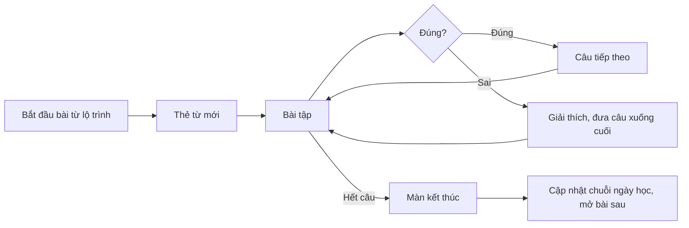

> **Mã:** DE03-TN02-PRD · **Trạng thái:** nháp · **Người viết:** Design (mock) · **SRS:** [SRS.md](SRS.md)

# PRD Học bài (App học tiếng Anh)

> **Bản mock.** Con số đánh dấu `[giả định]` dùng để dựng flow, cần PO xác nhận trước khi dùng.

## 1. Bối cảnh và vấn đề

### 1.1 Bối cảnh

Sau onboarding ([TN01](../TN01-kiem-tra-dau-vao-lo-trinh/PRD.md)), người học vào bài học đầu tiên. Bài học là nơi họ dành phần lớn thời gian trong app. Bài cần đủ ngắn để học trên xe buýt, đủ đa dạng để không chán, và cho phản hồi ngay để người học biết mình đúng hay sai.

### 1.2 Vấn đề

| **Vấn đề** | **Hệ quả** |
| --- | --- |
| Bài học dài 20–30 phút | Không có thời gian, bỏ dở |
| Chỉ có một dạng bài chọn đáp án | Nhàm chán, học thuộc mẹo thay vì học thật |
| Sai mà không biết vì sao | Lặp lại lỗi cũ |
| Luyện nói cần nói to ở nơi đông người | Ngại, bỏ qua kỹ năng nói |
| Thoát giữa bài là mất tiến độ | Ngại bắt đầu bài khi không chắc đủ thời gian |

### 1.3 Mục tiêu

- Một bài học hoàn thành trong 3–5 phút `[giả định]`.
- Tỉ lệ hoàn thành bài đã bắt đầu ≥ 85% `[giả định]`.
- Mỗi lỗi sai đều có giải thích ngắn bằng tiếng Việt.

## 2. Người dùng

| **Nhóm** | **Nhu cầu với tính năng này** |
| --- | --- |
| Người mất gốc | Bài dễ hiểu, giải thích bằng tiếng Việt, không bị dồn ép |
| Người đi làm | Tranh thủ 5 phút giữa giờ; luyện nói mà không cần nói to khi ở văn phòng |
| Sinh viên | Nhiều bài tập để luyện từ vựng và nghe |

## 3. Phạm vi

### 3.1 Trong phạm vi (MVP)

- Bài học gồm 10–15 bài tập ngắn, 3–5 phút.
- 6 dạng bài: thẻ từ mới, chọn nghĩa, ghép cặp, sắp xếp câu, nghe và chọn, nói lặp lại.
- Phản hồi ngay sau mỗi câu: đúng, sai, đáp án đúng, giải thích ngắn.
- Câu sai được hỏi lại ở cuối bài.
- Tạm tắt nói hoặc nghe trong 15 phút khi không tiện.
- Thoát giữa bài và học tiếp từ chỗ dừng.
- Màn kết thúc: độ chính xác, thời gian học, từ mới đã học.

### 3.2 Ngoài phạm vi

- Chấm phát âm chi tiết từng âm → phase sau.
- Hội thoại với AI, bài viết luận.
- Giới hạn số lần sai (mạng, trái tim).
- Bài học tự tạo của người dùng.

## 4. Nguyên tắc sản phẩm

### 4.1 Ngắn và trọn vẹn

Mỗi bài có điểm kết thúc rõ ràng trong vài phút. Người học luôn biết còn bao nhiêu câu.

### 4.2 Sai là để học

Sai không bị trừ điểm hay khoá bài. Mỗi câu sai có giải thích và được hỏi lại trong cùng bài.

### 4.3 Hợp với hoàn cảnh

Người học tạm tắt được bài nói hoặc nghe khi đang ở nơi không tiện, mà không bị phạt.

### 4.4 Không mất công sức

Thoát giữa bài, mất mạng hay có cuộc gọi đến đều không làm mất các câu đã làm.

## 5. Quy tắc nghiệp vụ

| **Quy tắc** | **Giá trị** `[giả định]` |
| --- | --- |
| Độ dài bài | 10–15 bài tập, 3–5 phút |
| Dạng bài | Thẻ từ mới, chọn nghĩa, ghép cặp, sắp xếp câu, nghe và chọn, nói lặp lại |
| Hoàn thành bài | Khi không còn câu nào chờ: mỗi câu đã trả lời đúng, hoặc đã hỏi lại đủ 2 lần và được xem đáp án |
| Câu sai | Đưa xuống cuối bài để hỏi lại; tối đa 2 lần hỏi lại mỗi câu; sau 2 lần vẫn sai thì hiện đáp án và đi tiếp, bài vẫn hoàn thành |
| Chấm nói | Nhận dạng giọng nói, đạt khi khớp ≥ 70% số từ |
| Tạm tắt nói, nghe | 15 phút; bài tập bị bỏ được thay bằng dạng khác |
| Giữ tiến độ bài dở | 24 giờ |
| Thời gian học tính vào mục tiêu ngày | Thời gian thực trong bài, không tính lúc app ở nền |

- Các giá trị trên là **cấu hình**, không cố định trong code.

## 6. Luồng trải nghiệm

| **Bước** | **Giai đoạn** | **Trải nghiệm** | **Đầu ra** |
| --- | --- | --- | --- |
| 1 | Bắt đầu | Chạm bài `DANG_MO` ở lộ trình; nội dung tải sẵn | Vào bài |
| 2 | Học từ mới | Thẻ từ: từ, phiên âm, nghĩa, ví dụ, nghe phát âm | Biết từ mới |
| 3 | Luyện tập | Các dạng bài xen kẽ; thanh tiến trình trên đầu | Bài làm |
| 4 | Phản hồi | Ngay sau mỗi câu: đúng hoặc sai, đáp án đúng, giải thích | Hiểu lỗi |
| 5 | Hỏi lại | Câu sai xuất hiện lại cuối bài | Sửa lỗi |
| 6 | Kết thúc | Độ chính xác, thời gian, từ mới đã học | Bài hoàn thành |
| 7 | Sau bài | Chuỗi ngày học, mục tiêu ngày cập nhật; bài sau mở khoá | Tiến độ mới |

## 7. Use Cases, User Stories và Acceptance Criteria

### UC1. Học một bài

#### US1.1 Làm bài tập

User Story: Là người học, tôi muốn học một bài ngắn với nhiều dạng bài tập để học được trong lúc rảnh mà không chán.

AC01: Bài bắt đầu bằng thẻ từ mới; mỗi thẻ có nút nghe phát âm.

AC02: Thanh tiến trình hiện số câu đã làm trên tổng; câu hỏi lại làm tổng tăng thêm.

AC03: Không có hai câu liên tiếp cùng dạng nếu bài còn dạng khác `[giả định]`.

AC04: Nút Kiểm tra chỉ bật khi đã chọn hoặc nhập câu trả lời.

#### US1.2 Nhận phản hồi

User Story: Là người học, tôi muốn biết ngay mình đúng hay sai và vì sao để không lặp lại lỗi.

AC01: Đúng → phản hồi tích cực ngắn, âm thanh nhẹ (tắt được), nút Tiếp tục.

AC02: Sai → hiện đáp án đúng và một câu giải thích bằng tiếng Việt.

AC03: Câu sai được hỏi lại ở cuối bài; trả lời đúng lần hỏi lại thì tính là đã sửa.

AC04: Đúng sai không chỉ thể hiện bằng màu mà có biểu tượng và chữ.

#### US1.3 Luyện nói và nghe phù hợp hoàn cảnh

User Story: Là người học, tôi muốn tạm tắt bài nói, bài nghe khi không tiện để vẫn học được ở nơi đông người.

AC01: Bài nói lặp lại: nghe mẫu, giữ nút để nói, app chấm đạt hoặc chưa đạt.

AC02: Mỗi bài nói và nghe có nút "Không tiện nói lúc này" hoặc "Không tiện nghe lúc này"; chọn thì tắt dạng đó trong 15 phút.

AC03: Chưa cấp quyền micro → giải thích lý do rồi mới hỏi quyền; từ chối thì thay bằng dạng bài khác.

### UC2. Thoát và học tiếp

#### US2.1 Thoát giữa bài

User Story: Là người học, tôi muốn thoát giữa bài mà không mất tiến độ để không ngại bắt đầu bài.

AC01: Bấm thoát → hỏi xác nhận, nói rõ tiến độ được giữ.

AC02: Quay lại bài trong 24 giờ → học tiếp từ câu đang dừng.

AC03: Cuộc gọi đến, app xuống nền → tạm dừng bài, không tính thời gian, không mất câu đã làm.

### UC3. Kết thúc bài

#### US3.1 Xem kết quả bài

User Story: Là người học, tôi muốn xem kết quả sau mỗi bài để biết mình làm tốt đến đâu và học gì tiếp theo.

AC01: Màn kết thúc hiện độ chính xác lần đầu, thời gian học, số từ mới.

AC02: Cập nhật tiến độ mục tiêu ngày và chuỗi ngày học (TN03).

AC03: Bài tiếp theo được mở khoá; có nút "Học bài tiếp" và "Về lộ trình".

AC04: Học lại bài đã hoàn thành vẫn tính thời gian học và ôn từ, không đổi thứ tự mở khoá.

## 8. Chỉ số theo dõi `[giả định]`

| **Chỉ số** | **Định nghĩa** | **Mục tiêu MVP** |
| --- | --- | --- |
| Tỉ lệ hoàn thành bài | Bài hoàn thành / bài đã bắt đầu | ≥ 85% |
| Thời lượng bài | Thời gian từ câu đầu tới màn kết thúc | 3–5 phút (trung vị) |
| Độ chính xác lần đầu | Câu đúng ngay lần đầu / tổng câu | 70–85%; ngoài khoảng là dấu hiệu bài quá dễ hoặc quá khó |
| Tỉ lệ tắt nói, nghe | Lượt chọn "Không tiện" / lượt gặp bài nói, nghe | Theo dõi |
| Tỉ lệ bỏ ở từng dạng bài | Lượt thoát tại dạng bài / lượt gặp dạng đó | Theo dõi |
| Tỉ lệ học tiếp bài dở | Bài dở được học tiếp / bài bị thoát | ≥ 50% |

## 9. Phụ thuộc và rủi ro

| **Mục** | **Mô tả** | **Hướng xử lý** |
| --- | --- | --- |
| Nội dung bài học | Cần đội nội dung soạn bài, giải thích, âm thanh | Bộ nội dung tối thiểu cho A1–A2 ở MVP |
| Nhận dạng giọng nói | Sai với giọng Việt, môi trường ồn | Ngưỡng 70%; luôn có nút bỏ qua; không chặn tiến độ |
| Âm thanh lỗi | Không phát được khi mạng yếu | Tải trước toàn bộ âm thanh của bài |
| Quyền micro | Người dùng từ chối | Thay dạng bài, nhắc bật trong Cài đặt |
| Bài quá dễ hoặc quá khó | Độ chính xác lệch | Theo dõi độ chính xác; gợi ý làm lại kiểm tra |

## 10. Câu hỏi mở

> Câu nào đã có giá trị ở mục 5 thì giá trị đó là **tạm chốt** `[giả định]` để dựng flow. Câu hỏi vẫn để mở cho đến khi PO xác nhận.

- Có giới hạn số lần sai (cơ chế "trái tim") để tăng tập trung không?
- Câu hỏi lại có đếm vào độ chính xác không, hay chỉ độ chính xác lần đầu?
- Bài nói có cần lưu bản ghi âm để người học nghe lại?
- Có cho bỏ qua thẻ từ mới khi đã biết từ đó?
