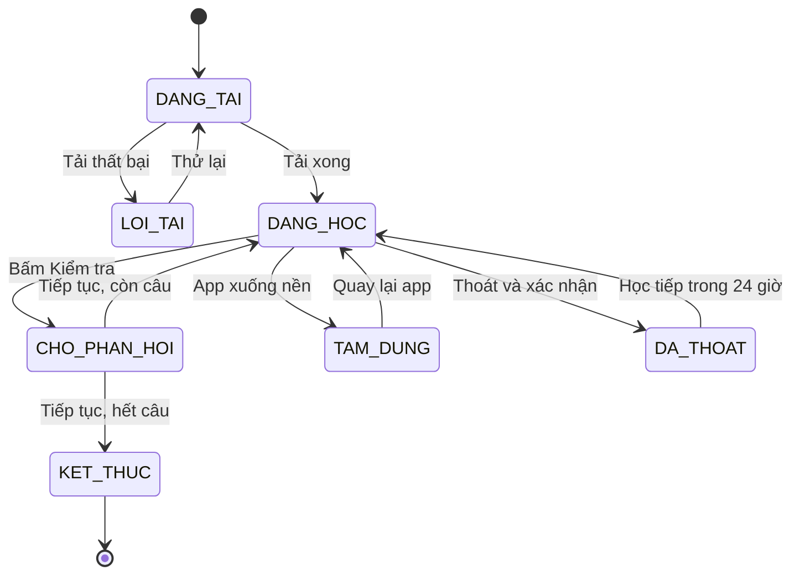
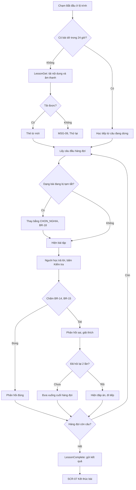
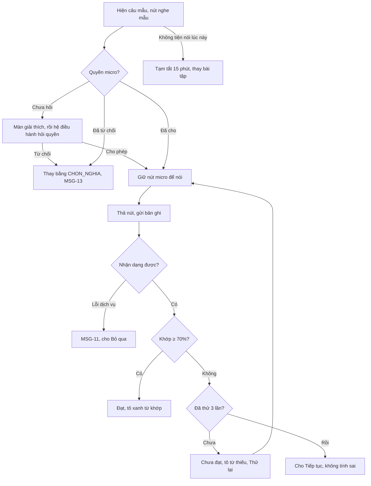
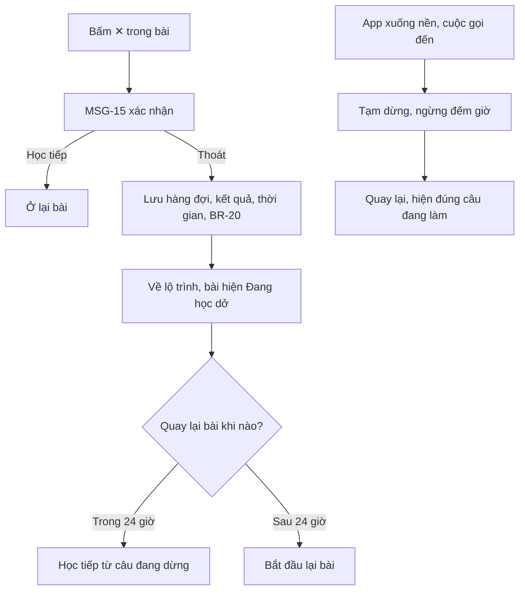
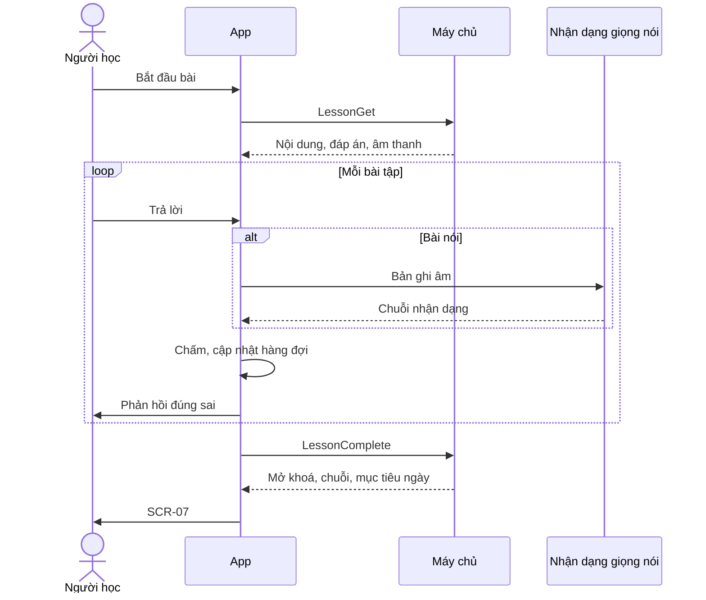

> **Mã:** DE03-TN02-SRS · **Trạng thái:** nháp · **Người viết:** Design (mock) · **PRD:** [PRD.md](PRD.md)

# UC-DE03-02 - Học bài

> **Bản mock.** Giá trị `[giả định]` cần BA xác nhận. Lộ trình và mở khoá xem [SRS TN01](../TN01-kiem-tra-dau-vao-lo-trinh/SRS.md); chuỗi ngày học và ôn tập xem [SRS TN03](../TN03-on-tap-streak/SRS.md).

## 1. Tổng quan

| **Mục** | **Nội dung** |
| --- | --- |
| Mục tiêu | Người học hoàn thành bài học 3–5 phút với nhiều dạng bài, nhận phản hồi ngay và sửa lỗi trong bài |
| Actor | Người học · Hệ thống (app) · Máy chủ nội dung · Dịch vụ nhận dạng giọng nói |
| Phạm vi | Tải bài, 6 dạng bài tập, chấm, phản hồi, hỏi lại, tạm tắt nói và nghe, thoát và học tiếp, màn kết thúc |
| Ngoài phạm vi | Chấm phát âm chi tiết, hội thoại AI, giới hạn số lần sai |
| Nền tảng | App iOS / Android `[giả định]` |
| Figma | `[chưa có]` |

## 2. User Story

| **ID** | **As a** | **I want** | **So that** |
| --- | --- | --- | --- |
| US-06 | Người học | Học bài ngắn nhiều dạng bài tập | Học được trong lúc rảnh, không chán |
| US-07 | Người học | Biết ngay đúng sai và lý do | Không lặp lại lỗi |
| US-08 | Người học | Được hỏi lại câu sai | Chắc chắn đã hiểu |
| US-09 | Người học | Tạm tắt bài nói, nghe khi không tiện | Vẫn học được ở nơi đông người |
| US-10 | Người học | Thoát giữa bài mà không mất tiến độ | Không ngại bắt đầu bài |

## 3. Business Rules

| **Mã** | **Quy tắc** |
| --- | --- |
| BR-11 | **Bài học** gồm 2–4 thẻ từ mới và 10–15 bài tập; toàn bộ nội dung và âm thanh tải trước khi bắt đầu `[giả định]` |
| BR-12 | **Dạng bài**: `THE_TU` (thẻ từ mới, không chấm), `CHON_NGHIA`, `GHEP_CAP` (4–5 cặp), `SAP_XEP_CAU`, `NGHE_CHON`, `NOI_LAP_LAI` |
| BR-13 | **Thứ tự**: theo nội dung bài; không xếp 2 bài tập cùng dạng liền nhau khi còn dạng khác |
| BR-14 | **Chấm**: `CHON_NGHIA`, `NGHE_CHON` so khớp đáp án; `GHEP_CAP` đạt khi ghép đúng hết, sai từng cặp thì cặp đó rung và trả lại; `SAP_XEP_CAU` so khớp câu, chấp nhận các đáp án tương đương do nội dung khai báo |
| BR-15 | **Chấm nói**: chuyển giọng nói thành chữ, đạt khi khớp ≥ 70% số từ của câu mẫu (bỏ dấu câu, không phân biệt hoa thường). Tối đa 3 lần thử mỗi câu; lần 3 chưa đạt thì cho "Tiếp tục" và không tính sai `[giả định]` |
| BR-16 | **Câu sai** được đưa xuống cuối hàng đợi để hỏi lại; mỗi câu hỏi lại tối đa 2 lần. Sau 2 lần vẫn sai thì hiện đáp án và đi tiếp |
| BR-17 | **Hoàn thành bài** khi hàng đợi trống, tức mỗi câu đã đúng hoặc đã hết 2 lần hỏi lại (BR-16); không yêu cầu đúng mọi câu. Độ chính xác = số câu đúng ngay lần đầu / số câu được chấm (không tính `THE_TU` và câu nói bị bỏ qua) |
| BR-18 | **Tạm tắt** "Không tiện nói" hoặc "Không tiện nghe": tắt dạng đó trong 15 phút trên toàn app; bài tập đang hiện được thay bằng bài cùng nội dung ở dạng `CHON_NGHIA` `[giả định]` |
| BR-19 | **Quyền micro**: hỏi lần đầu gặp `NOI_LAP_LAI`, có màn giải thích trước. Từ chối → thay dạng như BR-18, không hỏi lại trong phiên |
| BR-20 | **Thoát giữa bài**: lưu hàng đợi và kết quả đã có; giữ 24 giờ. Thời gian đã học tới lúc thoát (BR-21) được gửi ngay bằng \[StudyTimeAdd\] để cộng vào mục tiêu ngày (TN03 UC-07), kể cả khi bài không được học tiếp. App xuống nền → tạm dừng, không tính thời gian, và cũng gửi phần thời gian đã học |
| BR-21 | **Thời gian học** đếm khi bài đang hiện trên màn, dừng khi app ở nền hoặc bỏ tương tác quá 60 giây `[giả định]` |
| BR-22 | **Kết thúc bài**: gửi kết quả; bài chuyển `DA_HOAN_THANH`, mở bài kế tiếp (BR-09); từ mới được thêm vào sổ từ để ôn (TN03). Học lại bài đã hoàn thành: vẫn tính thời gian và cập nhật lịch ôn, không đổi mở khoá |

## 4. Trạng thái

### 4.1 Trạng thái một phiên học

### 4.2 Trạng thái một bài tập

| **Trạng thái** | **Điều kiện** | **Hiển thị** |
| --- | --- | --- |
| `CHUA_TRA_LOI` | Mới hiện | Nút Kiểm tra disabled |
| `DA_CHON` | Đã chọn hoặc sắp xếp | Nút Kiểm tra enabled |
| `DUNG` | Chấm đạt | Khung phản hồi đúng, biểu tượng tích, nút Tiếp tục |
| `SAI` | Chấm chưa đạt | Khung phản hồi sai, biểu tượng ✕, đáp án đúng, giải thích, nút Tiếp tục |
| `CHO_HOI_LAI` | Đã sai, chờ cuối bài | Không hiện; tổng câu trên thanh tiến trình tăng 1 |

## 5. Use Case

### UC-03 Học một bài

| **Mục** | **Nội dung** |
| --- | --- |
| Tiền điều kiện | Bài ở trạng thái `DANG_MO`, `DA_HOAN_THANH` hoặc `DA_VUOT_QUA` |
| Hậu điều kiện thành công | Bài `DA_HOAN_THANH`; kết quả, thời gian học, từ mới được lưu; bài sau mở khoá |
| Hậu điều kiện thất bại | Tiến độ đã làm được giữ theo BR-20 |

**Luồng chính**

| **Bước** | **Actor** | **Mô tả** |
| --- | --- | --- |
| 1 | Người học | Chạm "Bắt đầu" trên bài ở **SCR-04** |
| 2 | Hệ thống | Tải nội dung (\[LessonGet\]); tạo hàng đợi bài tập theo BR-13 |
| 3 | Hệ thống | Hiện các thẻ từ mới (`THE_TU`) ở **SCR-05** |
| 4 | Người học | Xem thẻ, nghe phát âm, bấm Tiếp |
| 5 | Hệ thống | Hiện bài tập đầu hàng đợi |
| 6 | Người học | Trả lời, bấm Kiểm tra |
| 7 | Hệ thống | Chấm (BR-14, BR-15), hiện **SCR-06** |
| 8 | Người học | Bấm Tiếp tục |
| 9 | Hệ thống | Câu sai → xuống cuối hàng đợi (BR-16); còn câu → bước 5 |
| 10 | Hệ thống | Hết hàng đợi → gửi kết quả (\[LessonComplete\]), mở **SCR-07** |

**Luồng thay thế**

| **Mã** | **Điều kiện** | **Xử lý** |
| --- | --- | --- |
| A1 | Có bài dở trong 24 giờ | Bước 2: khôi phục hàng đợi và kết quả đã có, bỏ qua thẻ từ đã xem |
| A2 | Dạng bài đang bị tạm tắt | Thay bằng `CHON_NGHIA` cùng nội dung (BR-18) |
| A3 | Bấm "Không tiện nói / nghe lúc này" | Bật tạm tắt 15 phút, thay bài tập hiện tại, hiện MSG-12 |
| A4 | Lần đầu gặp `NOI_LAP_LAI` | Màn giải thích quyền micro trước khi hệ điều hành hỏi (BR-19) |
| A5 | `GHEP_CAP` ghép sai một cặp | Cặp đó rung và trả lại, không kết thúc câu; câu tính sai lần đầu nếu có cặp sai |
| A6 | Học lại bài đã hoàn thành | Bước 10 không đổi mở khoá (BR-22) |

**Luồng lỗi**

| **Mã** | **Điều kiện** | **Xử lý** |
| --- | --- | --- |
| E1 | Tải nội dung thất bại | MSG-09, nút Thử lại |
| E2 | Âm thanh không phát được | MSG-10; với `NGHE_CHON` cho "Bỏ qua câu này", không tính sai |
| E3 | Dịch vụ nhận dạng giọng nói lỗi | MSG-11, cho "Bỏ qua", không tính sai |
| E4 | Gửi kết quả thất bại | Lưu kết quả trên máy, vẫn hiện **SCR-07**, gửi lại khi có mạng |

### UC-04 Luyện nói lặp lại

| **Mục** | **Nội dung** |
| --- | --- |
| Tiền điều kiện | Bài tập dạng `NOI_LAP_LAI`, dạng nói không bị tạm tắt |
| Hậu điều kiện | Câu được chấm đạt, chưa đạt, hoặc bỏ qua |

**Luồng chính**

| **Bước** | **Actor** | **Mô tả** |
| --- | --- | --- |
| 1 | Hệ thống | Hiện câu mẫu, nghĩa tiếng Việt, nút nghe mẫu |
| 2 | Người học | Nghe mẫu, giữ nút micro, nói, thả nút |
| 3 | Hệ thống | Nhận dạng (\[SpeechRecognize\]), so khớp theo BR-15 |
| 4 | Hệ thống | Đạt → **SCR-06** phản hồi đúng, tô các từ khớp |

**Luồng thay thế**

| **Mã** | **Điều kiện** | **Xử lý** |
| --- | --- | --- |
| A1 | Chưa đạt, còn lượt | Tô từ thiếu, nút "Thử lại" |
| A2 | Chưa đạt lần 3 | Nút "Tiếp tục", không tính sai (BR-15) |
| A3 | Giữ nút dưới 0,5 giây | MSG-14 "Giữ nút trong khi nói" |
| A4 | Không tiện nói | Như UC-03 A3 |

### UC-05 Thoát và học tiếp

| **Mục** | **Nội dung** |
| --- | --- |
| Tiền điều kiện | Đang trong bài |
| Hậu điều kiện | Tiến độ bài được giữ 24 giờ |

**Luồng chính**

| **Bước** | **Actor** | **Mô tả** |
| --- | --- | --- |
| 1 | Người học | Bấm ✕ khi đang trong bài |
| 2 | Hệ thống | Hiện MSG-15 hỏi xác nhận, nói rõ tiến độ được giữ 24 giờ |
| 3 | Người học | Chọn Thoát |
| 4 | Hệ thống | Lưu hàng đợi câu hỏi, kết quả; gửi thời gian đã học vào mục tiêu ngày (BR-20) |
| 5 | Hệ thống | Về lộ trình; bài hiện "Đang học dở" |
| 6 | Người học | Mở lại bài trong 24 giờ → học tiếp từ câu đang dừng |

**Luồng thay thế**

| **Mã** | **Điều kiện** | **Xử lý** |
| --- | --- | --- |
| A1 | Chọn Học tiếp ở MSG-15 | Ở lại bài, không lưu gì thêm |
| A2 | Quay lại sau 24 giờ | Bắt đầu lại bài từ đầu |
| A3 | App xuống nền hoặc có cuộc gọi đến | Tạm dừng bài, ngừng đếm giờ; quay lại hiện đúng câu đang làm |

## 6. Điểm vào

| **Điểm vào** | **Dẫn tới** | **Ghi chú** |
| --- | --- | --- |
| Nút "Bắt đầu" ở bài trên **SCR-04** | UC-03 | |
| Bài hiện "Đang học dở" trên **SCR-04** | UC-03 (A1) | |
| "Học bài tiếp" ở **SCR-07** | UC-03 | Bài kế tiếp trong lộ trình |
| Thông báo nhắc học | UC-03 | Mở bài `DANG_MO` (SRS TN03) |

## 7. Mô tả màn hình

### SCR-05 Bài tập

| **#** | **Thành phần** | **Loại** | **Hành vi** |
| --- | --- | --- | --- |
| 1 | Nút thoát | Icon ✕ | MSG-15 |
| 2 | Thanh tiến trình | Progress | Câu đã xong / tổng câu, gồm cả câu hỏi lại |
| 3 | Đề bài | Text | Hướng dẫn ngắn bằng tiếng Việt theo dạng bài |
| 4 | Vùng nội dung | Theo dạng | `THE_TU`: từ, phiên âm, nghĩa, ví dụ, nút nghe · `CHON_NGHIA`: từ hoặc câu + 4 đáp án · `GHEP_CAP`: 2 cột chạm để ghép · `SAP_XEP_CAU`: các thẻ từ chạm để xếp, chạm lại để gỡ · `NGHE_CHON`: nút phát, nút phát chậm, 4 đáp án · `NOI_LAP_LAI`: câu mẫu, nút nghe mẫu, nút micro giữ để nói |
| 5 | "Không tiện nói / nghe lúc này" | Button text | Chỉ ở `NOI_LAP_LAI`, `NGHE_CHON` |
| 6 | Nút Kiểm tra | Button | Disabled khi `CHUA_TRA_LOI`; ở `THE_TU` là nút Tiếp |

### SCR-06 Phản hồi đúng sai (khung trượt từ dưới lên)

| **#** | **Thành phần** | **Loại** | **Hành vi** |
| --- | --- | --- | --- |
| 1 | Kết quả | Biểu tượng + chữ | "Chính xác!" hoặc "Chưa đúng" |
| 2 | Đáp án đúng | Text | Chỉ khi sai |
| 3 | Giải thích | Text | Một câu tiếng Việt từ nội dung bài; chỉ khi sai |
| 4 | Nút nghe | Icon | Phát âm đáp án đúng |
| 5 | Báo lỗi nội dung | Link | Mở form ngắn báo câu hỏi sai |
| 6 | Tiếp tục | Button | Sang câu tiếp theo |

### SCR-07 Kết thúc bài

| **#** | **Thành phần** | **Loại** | **Hành vi** |
| --- | --- | --- | --- |
| 1 | Lời chúc | Tiêu đề | Theo độ chính xác: "Xuất sắc", "Làm tốt lắm", "Đã hoàn thành" |
| 2 | Chỉ số | 3 ô | Độ chính xác (%), Thời gian (phút), Từ mới |
| 3 | Mục tiêu hôm nay | Progress | "{x}/{y} phút"; đạt mục tiêu → hiệu ứng nhỏ |
| 4 | Chuỗi ngày học | Badge | Hiện nếu chuỗi vừa tăng (SRS TN03) |
| 5 | Học bài tiếp | Button | Mở bài kế tiếp |
| 6 | Về lộ trình | Button text | Về **SCR-04** |

## 8. API

| **API** | **Request chính** | **Response chính** | **Timeout / retry** `[giả định]` |
| --- | --- | --- | --- |
| \[LessonGet\] | lesson_id | Thẻ từ, bài tập (dạng, nội dung, đáp án, giải thích), link âm thanh | 8s / 2 lần |
| \[SpeechRecognize\] | audio, ngôn ngữ en-US | Chuỗi nhận dạng, độ tin cậy | 6s / không tự retry |
| \[LessonComplete\] | lesson_id, kết quả từng câu, thời gian học, accuracy | Bài kế tiếp mở khoá, từ mới thêm vào sổ, cập nhật mục tiêu ngày và chuỗi | 5s / gửi lại khi có mạng; idempotency key = lesson_id + session_id |
| \[StudyTimeAdd\] | lesson_id, session_id, số giây học chưa gửi, thời điểm học | Tiến độ ngày, chuỗi | 5s / gửi lại khi có mạng; idempotency key = session_id + số thứ tự lần gửi. \[LessonComplete\] chỉ gửi phần thời gian chưa gửi qua API này, để không cộng hai lần |
| \[ContentReport\] | exercise_id, lý do | – | 5s / 1 lần |

Chấm các dạng bài không phải nói chạy trên app với đáp án đã tải, để phản hồi ngay mà không chờ mạng.

**Map lỗi → thông báo**

| **Nhóm lỗi** | **Message** |
| --- | --- |
| Không tải được bài học | MSG-09 |
| Không phát được âm thanh | MSG-10 |
| Không nhận được giọng nói, nhận dạng quá thời gian | MSG-11 |
| Chưa có quyền micro | MSG-13 |
| Mất mạng khi gửi kết quả bài | MSG-18, gửi lại khi có mạng |
| Lỗi máy chủ khác | Thông báo lỗi chung của app (ngoài bộ MSG của SRS này), cho thử lại |

## 9. Danh sách thông báo

| **ID** | **Nơi hiện** | **Nội dung (VI)** |
| --- | --- | --- |
| MSG-09 | Màn lỗi | Không tải được bài học. Vui lòng kiểm tra kết nối. \[Thử lại\] |
| MSG-10 | Inline | Không phát được âm thanh. \[Phát lại\] \[Bỏ qua câu này\] |
| MSG-11 | Inline | Chưa nhận được giọng nói của bạn. \[Thử lại\] \[Bỏ qua\] |
| MSG-12 | Toast | Đã tạm tắt bài {nói / nghe} trong 15 phút |
| MSG-13 | Popup | Bài nói cần quyền dùng micro. Bạn có thể bật lại trong Cài đặt. \[Đã hiểu\] |
| MSG-14 | Inline | Giữ nút trong khi nói, thả ra khi nói xong |
| MSG-15 | Popup | Thoát bài học? Tiến độ của bạn được giữ trong 24 giờ. \[Học tiếp\] \[Thoát\] |
| MSG-16 | Popup | Bài nói cần micro để chấm phát âm của bạn. Âm thanh chỉ dùng để chấm, không lưu lại. \[Tiếp tục\] \[Để sau\] |
| MSG-17 | Toast | Cảm ơn bạn đã báo lỗi, chúng tôi sẽ kiểm tra |
| MSG-18 | Banner **SCR-07** | Đang ngoại tuyến. Kết quả sẽ được lưu khi có mạng |

Bản EN: `[chờ bổ sung]`.

## 10. Yêu cầu phi chức năng

| **Mục** | **Yêu cầu** `[giả định]` |
| --- | --- |
| Hiệu năng | Tải bài ≤ 3 giây trên 4G; phản hồi chấm ≤ 200 ms (trừ bài nói); chấm nói ≤ 3 giây |
| Offline | Sau khi tải, bài học làm được khi mất mạng (trừ bài nói); kết quả gửi lại sau |
| Quyền riêng tư | Bản ghi âm chỉ dùng để nhận dạng, không lưu trên máy chủ; nói rõ ở MSG-16 |
| Âm thanh | Tôn trọng chế độ im lặng; âm thanh phản hồi tắt được trong Cài đặt |
| Log / audit | Mỗi bài: thời điểm bắt đầu, kết thúc, độ chính xác, số câu bỏ qua; lỗi phát âm thanh và lỗi nhận dạng giọng nói kèm mã lỗi |
| Tracking | Bắt đầu, thoát (ở câu nào), hoàn thành; từng câu: dạng, đúng sai lần đầu, số lần hỏi lại; tạm tắt nói, nghe; quyền micro; báo lỗi nội dung |
| Accessibility | Đúng sai có biểu tượng và chữ; `GHEP_CAP` và `SAP_XEP_CAU` dùng chạm, không bắt buộc kéo thả; nút nghe và micro có nhãn đọc màn hình; tôn trọng cài đặt giảm chuyển động |
