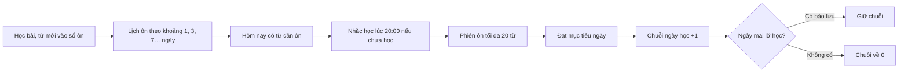

> **Mã:** DE03-TN03-PRD · **Trạng thái:** đã chốt · **Người viết:** Design · **SRS:** [SRS.md](SRS.md)

# PRD Ôn tập và chuỗi ngày học (App học tiếng Anh)

## 1. Bối cảnh và vấn đề

### 1.1 Bối cảnh

Học từ mới ở [TN02](../TN02-hoc-bai/PRD.md) chỉ có ích khi người học nhớ được lâu. Học ngoại ngữ cũng cần đều đặn mỗi ngày hơn là học dồn. Tính năng này gồm ba phần: ôn từ đúng lúc sắp quên, chuỗi ngày học để tạo thói quen, và nhắc học vào giờ người học chọn.

### 1.2 Vấn đề

| **Vấn đề** | **Hệ quả** |
| --- | --- |
| Học từ mới xong không ôn | Quên phần lớn sau một tuần |
| Ôn lại toàn bộ từ đã học | Mất thời gian vào từ đã thuộc |
| Không có lý do mở app mỗi ngày | Học thất thường, rồi bỏ |
| Lỡ một ngày là mất hết chuỗi | Nản, bỏ luôn |
| Nhắc học sai giờ, nhắc quá nhiều | Tắt thông báo hoặc gỡ app |

### 1.3 Mục tiêu

- Tỉ lệ giữ chân ngày 7 ≥ 35%, ngày 30 ≥ 15%.
- ≥ 50% người học hoạt động ôn tập ít nhất 3 ngày mỗi tuần.
- Tỉ lệ tắt thông báo nhắc học ≤ 10%.

## 2. Người dùng

| **Nhóm** | **Nhu cầu với tính năng này** |
| --- | --- |
| Người mất gốc | Được nhắc nhẹ nhàng, có động lực nhỏ mỗi ngày |
| Người đi làm | Nhắc vào giờ rảnh cố định, ví dụ giờ đi làm về |
| Sinh viên ôn thi | Ôn đúng từ sắp quên, không mất thời gian ôn từ đã thuộc |

## 3. Phạm vi

### 3.1 Trong phạm vi (MVP)

- Lịch ôn từ theo lặp lại ngắt quãng (spaced repetition) dựa trên kết quả trả lời.
- Phiên ôn tập tối đa 20 từ mỗi lượt.
- Chuỗi ngày học: đạt mục tiêu ngày thì chuỗi tăng.
- Ngày bảo lưu chuỗi: tự dùng khi lỡ một ngày.
- Nhắc học một lần mỗi ngày vào giờ người học chọn, không nhắc khi đã đạt mục tiêu.

### 3.2 Ngoài phạm vi

- Bảng xếp hạng, thi đua với bạn bè.
- Mua ngày bảo lưu bằng tiền hoặc điểm.
- Nhắc học qua email, SMS.
- Tự chọn thuật toán ôn tập.

## 4. Nguyên tắc sản phẩm

### 4.1 Ôn đúng lúc sắp quên

Từ trả lời đúng được giãn khoảng ôn dài hơn, từ trả lời sai được ôn lại sớm hơn. Người học chỉ ôn từ cần ôn hôm nay.

### 4.2 Thói quen hơn thành tích

Chuỗi ngày học khuyến khích học đều, không phạt nặng khi lỡ. Ngày bảo lưu giúp người học không mất hết công sức vì một ngày bận.

### 4.3 Nhắc như một người bạn

Một lần mỗi ngày, đúng giờ người học chọn, nội dung ngắn và cụ thể. Không nhắc khi đã học xong.

### 4.4 Minh bạch

Người học luôn thấy hôm nay cần ôn bao nhiêu từ, chuỗi hiện tại là bao nhiêu ngày, còn mấy ngày bảo lưu.

## 5. Quy tắc nghiệp vụ

| **Quy tắc** | **Giá trị** |
| --- | --- |
| Khoảng ôn | 1, 3, 7, 14, 30, 60 ngày; đúng thì lên mức, sai thì về mức 1 |
| Từ "đã thuộc" | Đạt mức 60 ngày và trả lời đúng |
| Phiên ôn tập | Tối đa 20 từ; ưu tiên từ quá hạn lâu nhất |
| Thời gian ôn | Tính vào mục tiêu ngày; bài học hoặc phiên ôn thoát giữa chừng vẫn được tính phần thời gian đã học |
| Tăng chuỗi | Đạt mục tiêu ngày trước 23:59 theo múi giờ thiết bị |
| Ngày bảo lưu | Tối đa giữ 2; được 1 ngày sau mỗi 7 ngày chuỗi liên tiếp |
| Lỡ ngày | Có bảo lưu → tự dùng, chuỗi giữ nguyên; không có → chuỗi về 0. Kết quả học ngoại tuyến của ngày đó gửi lên trong 72 giờ thì ngày và chuỗi được tính lại |
| Nhắc học | 1 lần mỗi ngày, giờ mặc định 20:00; không gửi khi đã đạt mục tiêu |

- Các giá trị trên là **cấu hình**, không cố định trong code.

## 6. Luồng trải nghiệm

| **Bước** | **Giai đoạn** | **Trải nghiệm** | **Đầu ra** |
| --- | --- | --- | --- |
| 1 | Có từ cần ôn | Thẻ Ôn tập trên lộ trình hiện số từ cần ôn hôm nay | Biết việc cần làm |
| 2 | Được nhắc | Thông báo vào giờ đã chọn nếu chưa đạt mục tiêu | Mở app |
| 3 | Ôn tập | Phiên ôn tối đa 20 từ, dạng bài nhanh | Lịch ôn cập nhật |
| 4 | Đạt mục tiêu | Màn kết thúc báo chuỗi tăng | Chuỗi +1 |
| 5 | Xem chuỗi | Lịch tháng các ngày đã học, số ngày bảo lưu | Động lực |
| 6 | Lỡ một ngày | Hôm sau mở app thấy ngày bảo lưu đã được dùng | Chuỗi được giữ |

## 7. Use Cases, User Stories và Acceptance Criteria

### UC1. Ôn tập

#### US1.1 Ôn từ cần ôn hôm nay

User Story: Là người học, tôi muốn ôn đúng những từ sắp quên để nhớ lâu mà không mất thời gian.

AC01: Thẻ Ôn tập hiện số từ cần ôn hôm nay; bằng 0 thì hiện ngày có từ cần ôn tiếp theo.

AC02: Phiên ôn tối đa 20 từ, ưu tiên từ quá hạn lâu nhất.

AC03: Mỗi từ được hỏi bằng một dạng bài nhanh (chọn nghĩa, nghe chọn, điền từ).

AC04: Đúng → từ lên mức khoảng ôn; sai → về mức 1 và hỏi lại cuối phiên. Trả lời đúng ở lần hỏi lại không làm từ lên mức.

AC05: Còn hơn 20 từ → kết thúc phiên có nút "Ôn tiếp {n} từ".

#### US1.2 Ôn một từ cụ thể

User Story: Là người học, tôi muốn ôn ngay một từ cụ thể để củng cố từ mình thấy chưa chắc.

AC01: Từ sổ từ vựng (TN04), chọn "Ôn từ này" để ôn ngay, không cần chờ đến hạn.

### UC2. Chuỗi ngày học

#### US2.1 Giữ chuỗi

User Story: Là người học, tôi muốn thấy chuỗi ngày học của mình để có động lực học mỗi ngày.

AC01: Đạt mục tiêu ngày → chuỗi tăng 1, hiện ở màn kết thúc bài và header lộ trình.

AC02: Màn chuỗi hiện lịch tháng: ngày đạt mục tiêu, ngày dùng bảo lưu, ngày lỡ.

AC03: Mỗi 7 ngày chuỗi liên tiếp được thêm 1 ngày bảo lưu, tối đa giữ 2.

#### US2.2 Lỡ một ngày

User Story: Là người học, tôi muốn không mất chuỗi chỉ vì lỡ một ngày để không nản.

AC01: Lỡ ngày và còn bảo lưu → tự dùng, chuỗi giữ nguyên; lần mở app tiếp theo báo đã dùng bảo lưu.

AC02: Lỡ ngày và không còn bảo lưu → chuỗi về 0; báo nhẹ nhàng, nêu chuỗi dài nhất đã đạt.

AC03: Đổi múi giờ → tính theo múi giờ mới từ ngày hôm sau, không làm mất chuỗi trong ngày đổi.

### UC3. Nhắc học

#### US3.1 Đặt giờ nhắc

User Story: Là người học, tôi muốn được nhắc học vào giờ tôi rảnh để không quên mà không bị làm phiền.

AC01: Chọn giờ nhắc, mặc định 20:00; bật tắt nhắc.

AC02: Chỉ nhắc khi hôm đó chưa đạt mục tiêu.

AC03: Nội dung nhắc cụ thể: số phút còn thiếu hoặc số từ cần ôn, chuỗi hiện tại.

AC04: Chạm thông báo mở thẳng phiên ôn tập nếu có từ cần ôn, nếu không thì mở bài `DANG_MO`.

AC05: Quyền thông báo bị tắt → màn cài đặt nhắc học nói rõ và có nút mở Cài đặt hệ thống.

## 8. Chỉ số theo dõi

| **Chỉ số** | **Định nghĩa** | **Mục tiêu MVP** |
| --- | --- | --- |
| Giữ chân ngày 7 / ngày 30 | Người học mở app ngày thứ 7 / 30 | ≥ 35% / ≥ 15% |
| Tỉ lệ ôn đều | Người học ôn ≥ 3 ngày mỗi tuần / người học hoạt động | ≥ 50% |
| Tỉ lệ nhớ | Từ đến hạn được trả lời đúng / từ đến hạn được ôn | ≥ 80% |
| Độ dài chuỗi | Trung vị chuỗi hiện tại của người học hoạt động | Theo dõi |
| Tỉ lệ mở từ thông báo | Thông báo được mở / thông báo gửi | ≥ 15% |
| Tỉ lệ tắt nhắc | Người tắt nhắc học / người từng bật | ≤ 10% |

## 9. Phụ thuộc và rủi ro

| **Mục** | **Mô tả** | **Hướng xử lý** |
| --- | --- | --- |
| Dồn từ cần ôn | Nghỉ nhiều ngày, quay lại thấy hàng trăm từ | Mỗi phiên tối đa 20 từ; nói rõ "Ôn dần mỗi ngày" |
| Áp lực chuỗi | Người học lo lắng, gian lận giờ hệ thống | Có ngày bảo lưu; không hiện chuỗi quá to; không thưởng vật chất |
| Múi giờ | Đi công tác làm lệch ngày | Tính theo múi giờ thiết bị; ngày đổi múi giờ được ưu ái |
| Quyền thông báo | Bị từ chối hoặc hệ điều hành gom thông báo | Nhắc trong app khi mở; giải thích lợi ích trước khi hỏi quyền |

## 10. Câu hỏi mở

> Mọi câu hỏi dưới đây đã được PO chốt ngày 13/11/2026; quyết định ghi sau mỗi câu và đã cập nhật vào SRS.

- Có cho người học tự sửa (khôi phục) chuỗi trong 24 giờ không? → **Đã chốt:** Không. Chuỗi được giữ bằng ngày bảo lưu tự động, và kết quả ngoại tuyến gửi muộn trong 72 giờ được tính lại (SRS BR-29, BR-30).
- Khoảng ôn có nên điều chỉnh theo độ khó của từ không? → **Đã chốt:** Có. Mỗi từ có hệ số độ khó nhân vào khoảng ôn (SRS BR-23).
- Ôn tập có tính là đạt mục tiêu ngày nếu không học bài mới? → **Đã chốt:** Có. Thời gian ôn tập tính vào mục tiêu ngày (SRS BR-27).
- Có thêm lần nhắc thứ hai trước khi hết ngày khi chuỗi sắp mất? → **Đã chốt:** Không. Tối đa 1 lần nhắc mỗi ngày (SRS BR-31).
