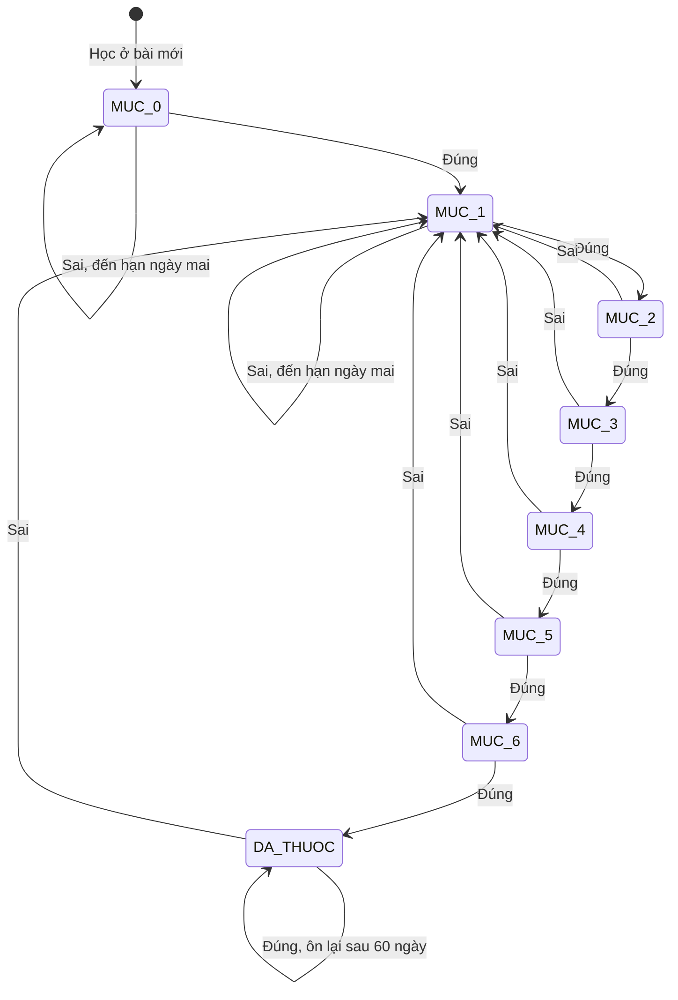
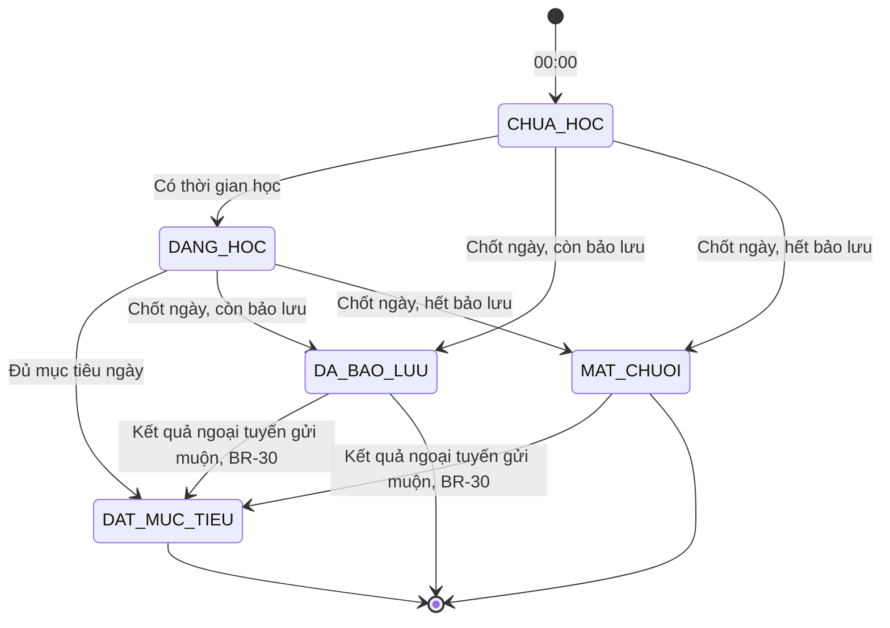
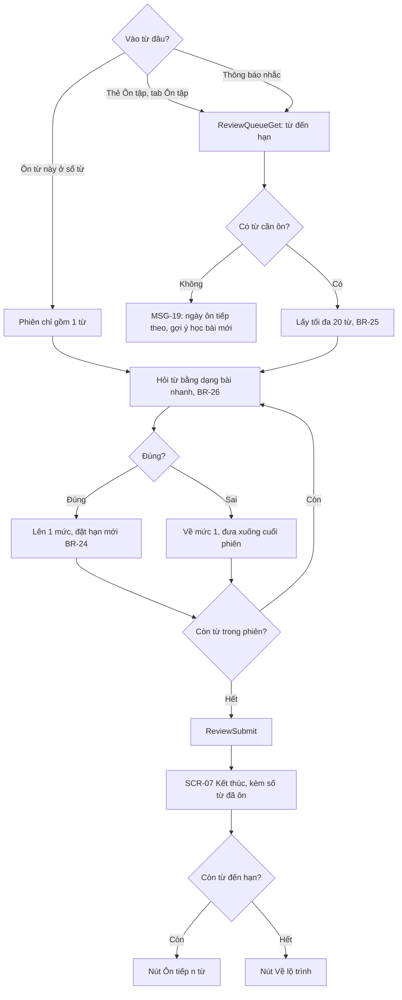
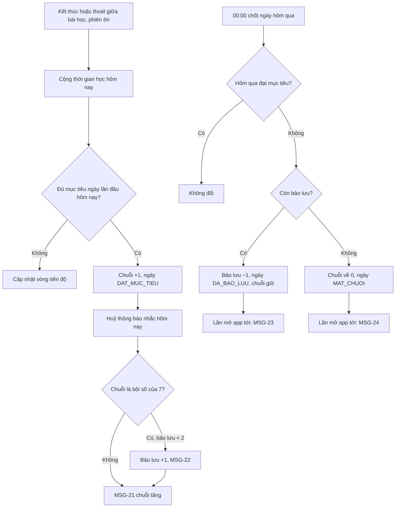
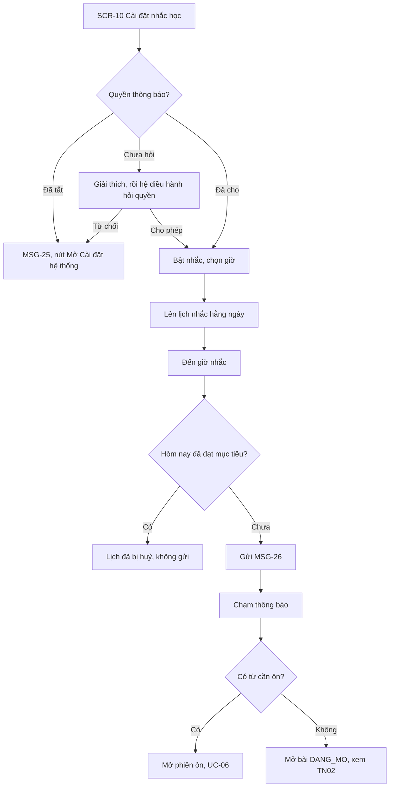
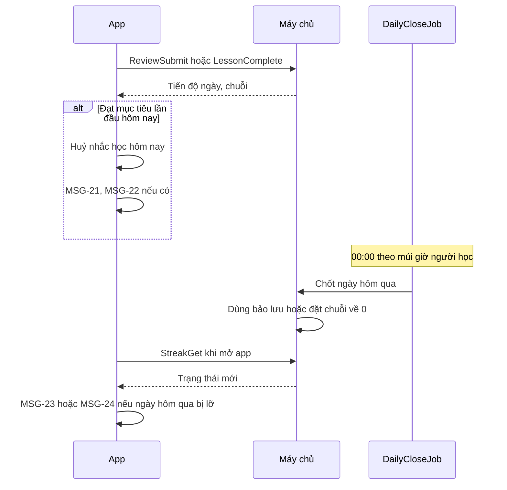

> **Mã:** DE03-TN03-SRS · **Trạng thái:** nháp · **Người viết:** Design (mock) · **PRD:** [PRD.md](PRD.md)

# UC-DE03-03 - Ôn tập và chuỗi ngày học

> **Bản mock.** Giá trị `[giả định]` cần BA xác nhận. Dạng bài tập dùng lại từ [SRS TN02](../TN02-hoc-bai/SRS.md); sổ từ vựng xem [SRS TN04](../TN04-theo-doi-tien-do/SRS.md).

## 1. Tổng quan

| **Mục** | **Nội dung** |
| --- | --- |
| Mục tiêu | Người học ôn từ đúng lúc sắp quên, duy trì chuỗi ngày học và được nhắc học đúng giờ |
| Actor | Người học · Hệ thống (app) · Máy chủ · Dịch vụ thông báo đẩy |
| Phạm vi | Lịch ôn, phiên ôn tập, chuỗi ngày học, ngày bảo lưu, nhắc học |
| Ngoài phạm vi | Bảng xếp hạng, mua bảo lưu, nhắc qua email, SMS |
| Nền tảng | App iOS / Android `[giả định]` |

## 2. User Story

| **ID** | **As a** | **I want** | **So that** |
| --- | --- | --- | --- |
| US-11 | Người học | Ôn từ cần ôn hôm nay | Nhớ lâu mà không ôn thừa |
| US-12 | Người học | Thấy chuỗi ngày học | Có động lực học mỗi ngày |
| US-13 | Người học | Không mất chuỗi vì lỡ một ngày | Không nản |
| US-14 | Người học | Được nhắc vào giờ mình chọn | Không quên học |
| US-15 | Người học | Không bị nhắc khi đã học xong | Không bị làm phiền |

## 3. Business Rules

| **Mã** | **Quy tắc** |
| --- | --- |
| BR-23 | **Mức ôn** của mỗi từ: 0 (mới học) đến 6. Khoảng ôn theo mức: 1, 1, 3, 7, 14, 30, 60 ngày `[giả định]`. Từ mới học ở TN02 vào mức 0, đến hạn ngày hôm sau. **Điều chỉnh theo độ khó**: mỗi từ có hệ số `ease` bắt đầu 1,0; mỗi lần sai ở lần trả lời đầu giảm 0,2 (tối thiểu 0,6); đúng ngay 3 lần liên tiếp tăng 0,1 (tối đa 1,3). Khoảng ôn thực tế = khoảng theo mức × `ease`, làm tròn ngày, tối thiểu 1 ngày `[giả định]`. **Từ "Đã biết"** (người học tự đánh dấu ở thẻ từ hoặc sổ từ): `known = true`, không vào phiên ôn; bỏ đánh dấu thì từ quay lại mức 0, đến hạn ngày mai |
| BR-24 | **Cập nhật sau mỗi lần ôn**: đúng → lên 1 mức, đến hạn = hôm nay + khoảng của mức mới (đã nhân `ease`, BR-23); sai → về mức 1 (đang ở mức 0 thì giữ mức 0), đến hạn ngày mai, và hỏi lại cuối phiên. Mức ôn chỉ tính theo **lần trả lời đầu tiên** của từ trong phiên: trả lời đúng ở lần hỏi lại cuối phiên không lên mức và không đổi đến hạn. Đúng ở mức 6 → đánh dấu "Đã thuộc", vẫn ôn mỗi 60 ngày |
| BR-25 | **Từ cần ôn hôm nay** = từ có đến hạn ≤ hôm nay và không "Đã biết" (BR-23). **Phiên ôn** lấy tối đa 20 từ, ưu tiên từ quá hạn lâu nhất, sau đó mức thấp hơn trước |
| BR-26 | **Dạng bài ôn**: chọn ngẫu nhiên trong `CHON_NGHIA`, `NGHE_CHON`, điền từ còn thiếu; áp dụng tạm tắt nghe của BR-18 |
| BR-27 | **Đạt mục tiêu ngày** khi tổng thời gian học (bài học + ôn tập, BR-21) trong ngày ≥ mục tiêu ngày. Ngày tính theo múi giờ thiết bị, từ 00:00 đến 23:59 |
| BR-28 | **Chuỗi**: đạt mục tiêu ngày thì chuỗi +1 (tối đa 1 lần mỗi ngày). Lưu chuỗi hiện tại và chuỗi dài nhất |
| BR-29 | **Ngày bảo lưu**: được 1 ngày khi chuỗi chạm mỗi bội số của 7; giữ tối đa 2 `[giả định]` |
| BR-30 | **Chốt ngày** lúc 00:00: hôm qua chưa đạt mục tiêu → còn bảo lưu thì trừ 1, chuỗi giữ nguyên, ngày đó ghi "Đã bảo lưu"; hết bảo lưu thì chuỗi về 0. Lỡ nhiều ngày liền thì dùng bảo lưu cho từng ngày cho tới khi hết. **Mở lại ngày đã chốt**: kết quả học ngoại tuyến mang thời điểm học thuộc ngày đã chốt, gửi lên trong vòng 72 giờ sau khi ngày đó kết thúc `[giả định]`, được cộng vào ngày đó. Nếu nhờ vậy ngày đó đạt mục tiêu thì ngày chuyển `DAT_MUC_TIEU` và chuỗi được tính lại từ ngày đó: hoàn bảo lưu đã trừ, hoặc khôi phục chuỗi đã về 0 rồi cộng tiếp các ngày đạt sau đó. Quá 72 giờ → chỉ cộng thời gian vào thống kê, không đổi chuỗi. Thời điểm học ở tương lai so với giờ máy chủ bị từ chối |
| BR-31 | **Nhắc học**: tối đa 1 lần mỗi ngày vào giờ đã chọn (mặc định 20:00); không gửi nếu hôm đó đã đạt mục tiêu; gửi theo lịch cục bộ trên máy, huỷ ngay khi đạt mục tiêu `[giả định]` |
| BR-32 | **Đổi múi giờ**: ngày đang diễn ra giữ theo múi giờ cũ đến hết ngày; từ ngày hôm sau theo múi giờ mới |

## 4. Trạng thái

### 4.1 Mức ôn của một từ

### 4.2 Trạng thái một ngày trong chuỗi

| **Trạng thái ngày** | **Hiển thị trên lịch SCR-09** |
| --- | --- |
| `DAT_MUC_TIEU` | Ô tô đầy kèm biểu tượng ngọn lửa |
| `DA_BAO_LUU` | Ô có biểu tượng khiên |
| `MAT_CHUOI` | Ô trống viền mảnh |
| `DANG_HOC` (hôm nay) | Vòng tiến độ "{x}/{y} phút" |

## 5. Use Case

### UC-06 Ôn tập

| **Mục** | **Nội dung** |
| --- | --- |
| Tiền điều kiện | Có ≥ 1 từ cần ôn hôm nay, hoặc người học chọn "Ôn từ này" |
| Hậu điều kiện thành công | Mức ôn và ngày đến hạn của các từ được cập nhật; thời gian ôn cộng vào mục tiêu ngày |
| Hậu điều kiện thất bại | Từ đã ôn trong phiên vẫn được cập nhật; từ chưa ôn giữ nguyên |

**Luồng chính**

| **Bước** | **Actor** | **Mô tả** |
| --- | --- | --- |
| 1 | Người học | Chạm thẻ Ôn tập ở **SCR-04** hoặc tab Ôn tập |
| 2 | Hệ thống | Lấy từ đến hạn (\[ReviewQueueGet\]); tạo phiên tối đa 20 từ (BR-25) |
| 3 | Hệ thống | Mở **SCR-08**, hỏi từng từ bằng dạng bài nhanh (BR-26) |
| 4 | Người học | Trả lời |
| 5 | Hệ thống | Phản hồi như **SCR-06**; cập nhật mức ôn theo BR-24 |
| 6 | Hệ thống | Hết phiên: gửi kết quả (\[ReviewSubmit\]), mở **SCR-07** |

**Luồng thay thế**

| **Mã** | **Điều kiện** | **Xử lý** |
| --- | --- | --- |
| A1 | Không có từ cần ôn | MSG-19 |
| A2 | Còn hơn 20 từ đến hạn | **SCR-07** có nút "Ôn tiếp {n} từ" |
| A3 | Ôn từ cụ thể từ sổ từ | Phiên 1 từ; cập nhật mức như ôn thường |
| A4 | Có > 100 từ quá hạn | **SCR-08** hiện MSG-20 trước phiên đầu tiên |
| A5 | Thoát giữa phiên | Từ đã trả lời được cập nhật; không giữ phiên dở |

**Luồng lỗi**

| **Mã** | **Điều kiện** | **Xử lý** |
| --- | --- | --- |
| E1 | Mất mạng | Dùng danh sách từ đã đồng bộ gần nhất; kết quả gửi khi có mạng |

### UC-07 Cập nhật chuỗi ngày học

| **Mục** | **Nội dung** |
| --- | --- |
| Tiền điều kiện | Hồ sơ có mục tiêu ngày |
| Hậu điều kiện | Chuỗi, chuỗi dài nhất, số ngày bảo lưu, trạng thái ngày được cập nhật |

**Luồng chính**

| **Bước** | **Actor** | **Mô tả** |
| --- | --- | --- |
| 1 | Hệ thống | Sau mỗi bài học hoặc phiên ôn, và mỗi khi người học thoát giữa bài hoặc app xuống nền (TN02 BR-20), cộng thời gian học của ngày (BR-27) |
| 2 | Hệ thống | Lần đầu đạt mục tiêu trong ngày → chuỗi +1 (BR-28), huỷ nhắc học hôm nay (BR-31) |
| 3 | Hệ thống | Chuỗi chạm bội số của 7 → cộng bảo lưu nếu chưa đủ 2 (BR-29) |
| 4 | Hệ thống | Hiện MSG-21 (và MSG-22 nếu có) ở **SCR-07** |
| 5 | Hệ thống | 00:00: chốt ngày hôm qua theo BR-30 |

**Luồng thay thế**

| **Mã** | **Điều kiện** | **Xử lý** |
| --- | --- | --- |
| A1 | Lỡ nhiều ngày liền | Dùng bảo lưu cho từng ngày cho tới khi hết, rồi chuỗi về 0 |
| A2 | App không mở lúc 00:00 | Chốt bù khi mở app hoặc khi máy chủ đồng bộ |
| A3 | Đổi múi giờ | Theo BR-32 |
| A4 | Đổi mục tiêu ngày | Áp dụng từ ngày hôm sau (BR-08); không ảnh hưởng ngày đang diễn ra |
| A5 | Kết quả học ngoại tuyến của ngày đã chốt được gửi muộn | Trong 72 giờ: cộng vào ngày đó, tính lại trạng thái ngày và chuỗi theo BR-30; lần mở app tới không hiện MSG-23, MSG-24 cho ngày đã được sửa. Quá 72 giờ: chỉ cộng vào thống kê |

### UC-08 Cài đặt nhắc học

| **Mục** | **Nội dung** |
| --- | --- |
| Tiền điều kiện | Không có |
| Hậu điều kiện | Lịch nhắc cục bộ được tạo hoặc huỷ theo cài đặt |

**Luồng chính**

| **Bước** | **Actor** | **Mô tả** |
| --- | --- | --- |
| 1 | Người học | Mở **SCR-10** Cài đặt nhắc học |
| 2 | Hệ thống | Kiểm tra quyền thông báo; đã cho phép → hiện công tắc nhắc và ô chọn giờ |
| 3 | Người học | Bật nhắc, chọn giờ |
| 4 | Hệ thống | Lên lịch nhắc hằng ngày trên máy |
| 5 | Hệ thống | Đến giờ nhắc mà hôm nay chưa đạt mục tiêu → gửi MSG-26 |
| 6 | Người học | Chạm thông báo |
| 7 | Hệ thống | Có từ cần ôn → mở phiên ôn (UC-06); không có → mở bài `DANG_MO` (SRS TN02) |

**Luồng thay thế**

| **Mã** | **Điều kiện** | **Xử lý** |
| --- | --- | --- |
| A1 | Chưa từng hỏi quyền thông báo | Giải thích lý do trước, rồi hệ điều hành hỏi quyền; cho phép → bước 3 |
| A2 | Hôm nay đã đạt mục tiêu trước giờ nhắc | Lịch nhắc của ngày bị huỷ, không gửi |

**Luồng lỗi**

| **Mã** | **Điều kiện** | **Xử lý** |
| --- | --- | --- |
| E1 | Quyền thông báo đã tắt hoặc bị từ chối | MSG-25 kèm nút Mở Cài đặt hệ thống; công tắc nhắc giữ tắt |

## 6. Điểm vào

| **Điểm vào** | **Dẫn tới** | **Ghi chú** |
| --- | --- | --- |
| Thẻ Ôn tập ở **SCR-04** | UC-06 | Hiện số từ cần ôn |
| Tab Ôn tập | UC-06, **SCR-08** | Badge số từ cần ôn |
| "Ôn từ này" ở **SCR-12** | UC-06 (A3) | SRS TN04 |
| Biểu tượng chuỗi ở header **SCR-04** | **SCR-09** | |
| Hồ sơ → Nhắc học | UC-08, **SCR-10** | |
| Thông báo nhắc học | UC-06 hoặc bài học | Theo UC-08 |

## 7. Mô tả màn hình

### SCR-08 Ôn tập

| **#** | **Thành phần** | **Loại** | **Hành vi** |
| --- | --- | --- | --- |
| 1 | Tóm tắt trước phiên | Card | "{n} từ cần ôn hôm nay"; nút "Bắt đầu ôn"; MSG-20 khi > 100 từ |
| 2 | Thanh tiến trình | Progress | Từ đã ôn / số từ trong phiên |
| 3 | Bài tập | Theo dạng | Dùng lại thành phần của **SCR-05** |
| 4 | Phản hồi | Khung trượt | Dùng lại **SCR-06**, thêm dòng "Ôn lại sau {n} ngày" khi đúng |
| 5 | Màn trống | Empty state | MSG-19 |

### SCR-09 Chuỗi ngày học

| **#** | **Thành phần** | **Loại** | **Hành vi** |
| --- | --- | --- | --- |
| 1 | Chuỗi hiện tại | Số lớn | "{n} ngày liên tiếp" |
| 2 | Chuỗi dài nhất | Text phụ | "Kỷ lục: {n} ngày" |
| 3 | Ngày bảo lưu | Badge | "{x}/2 ngày bảo lưu" kèm giải thích ngắn khi chạm |
| 4 | Hôm nay | Progress vòng | "{x}/{y} phút" |
| 5 | Lịch tháng | Calendar | Ô theo trạng thái mục 4.2; nút tháng trước, sau |
| 6 | Cài đặt nhắc học | Link | Mở **SCR-10** |

### SCR-10 Cài đặt nhắc học

| **#** | **Thành phần** | **Loại** | **Hành vi** |
| --- | --- | --- | --- |
| 1 | Bật nhắc học | Toggle | Bật lần đầu → xin quyền thông báo |
| 2 | Giờ nhắc | Time picker | Mặc định 20:00 |
| 3 | Mục tiêu ngày | Link | Đổi mục tiêu ngày (BR-08) |
| 4 | Cảnh báo quyền | Banner | MSG-25 khi quyền thông báo bị tắt |
| 5 | Xem trước | Card | Mẫu nội dung thông báo |

## 8. API

| **API** | **Request chính** | **Response chính** | **Timeout / retry** `[giả định]` |
| --- | --- | --- | --- |
| \[ReviewQueueGet\] | profile_id, ngày | Từ đến hạn, mức ôn, nội dung bài ôn | 5s / 1 lần; cache cho ngoại tuyến |
| \[ReviewSubmit\] | Kết quả từng từ (lần trả lời đầu và lần hỏi lại), thời gian ôn, thời điểm học | Mức ôn mới, đến hạn mới, tiến độ ngày, chuỗi | 5s / gửi lại khi có mạng |
| \[StreakGet\] | profile_id, tháng | Chuỗi, kỷ lục, bảo lưu, trạng thái từng ngày | 5s / 1 lần |
| \[DailyCloseJob\] | Chạy trên máy chủ theo múi giờ từng người | Cập nhật chuỗi theo BR-30 | Chạy mỗi giờ cho các múi giờ vừa qua 00:00; tính lại ngày đã chốt khi nhận kết quả gửi muộn trong 72 giờ |
| \[ReminderSettingsSave\] | enabled, time, timezone | – | 5s / 2 lần |

Nhắc học được lên lịch cục bộ trên thiết bị, để huỷ được ngay khi đạt mục tiêu mà không cần mạng.

**Mô hình dữ liệu**

| **Đối tượng** | **Trường** |
| --- | --- |
| ReviewItem | word_id, profile_id, level (0–6), ease (0,6–1,3), due_date, last_result, mastered, known |
| DailyProgress | profile_id, date, minutes, goal_minutes, status |
| Streak | profile_id, current, longest, freezes (0–2), timezone |

**Map lỗi → thông báo**

| **Nhóm lỗi** | **Message** |
| --- | --- |
| Không lấy được danh sách từ cần ôn | Thông báo lỗi chung của app (ngoài bộ MSG của SRS này), cho thử lại |
| Mất mạng khi gửi kết quả ôn | Lưu trên máy, tự gửi lại khi có mạng; không chặn người học |
| Quyền thông báo của hệ điều hành đang tắt | MSG-25 |
| Lưu cài đặt nhắc học thất bại | Thông báo lỗi chung của app (ngoài bộ MSG của SRS này), cho thử lại; giữ giá trị cũ |

## 9. Danh sách thông báo

| **ID** | **Nơi hiện** | **Nội dung (VI)** |
| --- | --- | --- |
| MSG-19 | **SCR-08** | Bạn đã ôn hết từ hôm nay. Lần ôn tiếp theo: {ngày}. \[Học bài mới\] |
| MSG-20 | **SCR-08** | Bạn có {n} từ cần ôn. Ôn dần 20 từ mỗi lượt để nhớ tốt hơn |
| MSG-21 | **SCR-07** | Chuỗi {n} ngày! Hẹn gặp bạn ngày mai |
| MSG-22 | **SCR-07** | Bạn nhận thêm 1 ngày bảo lưu ({x}/2) |
| MSG-23 | Popup khi mở app | Hôm qua bạn chưa học, 1 ngày bảo lưu đã được dùng để giữ chuỗi {n} ngày |
| MSG-24 | Popup khi mở app | Chuỗi ngày học đã bắt đầu lại. Kỷ lục của bạn là {n} ngày, hãy bắt đầu chuỗi mới hôm nay |
| MSG-25 | Banner **SCR-10** | Thông báo đang tắt nên app chưa nhắc bạn được. \[Mở Cài đặt\] |
| MSG-26 | Thông báo đẩy | {Còn {x} phút để đạt mục tiêu / Có {n} từ đang chờ ôn}. Giữ chuỗi {n} ngày nhé! |

## 10. Yêu cầu phi chức năng

| **Mục** | **Yêu cầu** `[giả định]` |
| --- | --- |
| Hiệu năng | **SCR-08** tải ≤ 2 giây; cập nhật chuỗi hiện ngay ở **SCR-07** (≤ 500 ms sau khi gửi kết quả) |
| Đồng bộ | Chuỗi tính trên máy chủ là nguồn đúng; app hiện số tạm khi ngoại tuyến và đồng bộ lại khi có mạng |
| Thời gian | Không dựa vào giờ thiết bị để chốt ngày; máy chủ dùng múi giờ đã lưu (BR-32) |
| Thông báo | Tối đa 1 thông báo nhắc học mỗi ngày; không gửi 22:00–07:00 nếu người học không tự chọn giờ đó |
| Bảo mật | Kết quả ôn và chuỗi ngày học chỉ người học thấy; giờ nhắc lưu theo tài khoản, không chia sẻ cho bên thứ ba |
| Log / audit | Mỗi lần chốt ngày: đạt mục tiêu hay không, chuỗi trước và sau, bảo lưu đã dùng; mỗi lần đổi múi giờ, đổi giờ nhắc |
| Tracking | Bắt đầu và kết thúc phiên ôn (số từ, tỉ lệ đúng); chuỗi tăng; dùng bảo lưu; mất chuỗi; bật, tắt nhắc; giờ nhắc; thông báo gửi, mở |
| Accessibility | Lịch chuỗi có nhãn chữ cho từng trạng thái ngày; số chuỗi được trình đọc màn hình đọc đầy đủ; không dùng hiệu ứng nhấp nháy |
