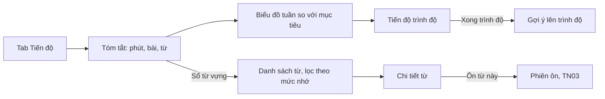

> **Mã:** DE03-TN04-PRD · **Trạng thái:** nháp · **Người viết:** Design (mock) · **SRS:** [SRS.md](SRS.md)

# PRD Theo dõi tiến độ (App học tiếng Anh)

> **Bản mock.** Con số đánh dấu `[giả định]` dùng để dựng flow, cần PO xác nhận trước khi dùng.

## 1. Bối cảnh và vấn đề

### 1.1 Bối cảnh

Người học đã học bài ([TN02](../TN02-hoc-bai/PRD.md)) và ôn tập đều ([TN03](../TN03-on-tap-streak/PRD.md)). Học ngoại ngữ là việc dài hơi, tiến bộ khó thấy trong từng ngày. Tính năng này cho người học thấy công sức đã bỏ ra và khoảng cách còn lại tới trình độ tiếp theo.

### 1.2 Vấn đề

| **Vấn đề** | **Hệ quả** |
| --- | --- |
| Không thấy mình tiến bộ | Mất động lực sau vài tuần |
| Không biết đã học bao nhiêu từ | Không đánh giá được vốn từ |
| Không biết còn bao xa tới trình độ tiếp theo | Không có mục tiêu trung hạn |
| Muốn xem lại từ đã học nhưng không có chỗ | Phải học lại bài cũ để tìm từ |
| Số liệu quá nhiều, khó hiểu | Không xem |

### 1.3 Mục tiêu

- ≥ 40% người học hoạt động mở màn Tiến độ ít nhất 1 lần mỗi tuần `[giả định]`.
- Người học trả lời được "tuần này tôi đã học bao nhiêu" trong ≤ 5 giây `[giả định]`.
- Sổ từ vựng là nơi duy nhất để xem lại mọi từ đã học.

## 2. Người dùng

| **Nhóm** | **Nhu cầu với tính năng này** |
| --- | --- |
| Người mất gốc | Thấy những bước tiến nhỏ để có động lực |
| Người đi làm | Biết tuần này học bao nhiêu phút so với tuần trước |
| Sinh viên ôn thi | Biết vốn từ hiện có, xem lại từ hay sai |

## 3. Phạm vi

### 3.1 Trong phạm vi (MVP)

- Tóm tắt: tổng thời gian học, số bài hoàn thành, số từ đã học, số từ đã thuộc.
- Biểu đồ thời gian học theo ngày trong tuần, so với mục tiêu ngày.
- Tiến độ trình độ: số chặng đã xong trên tổng số chặng của trình độ hiện tại.
- Sổ từ vựng: danh sách từ đã học, mức nhớ, tìm kiếm, lọc theo mức nhớ.
- Chi tiết một từ: nghĩa, phiên âm, ví dụ, lịch ôn, ôn ngay.

### 3.2 Ngoài phạm vi

- Báo cáo tiến độ gửi qua email.
- So sánh với người học khác.
- Thống kê theo kỹ năng nghe, nói, đọc, viết → phase sau.
- Xuất sổ từ vựng.

## 4. Nguyên tắc sản phẩm

### 4.1 Công sức trước, điểm số sau

Ưu tiên hiện những gì người học đã làm được: phút học, bài hoàn thành, từ đã học.

### 4.2 So với chính mình

Chỉ so tuần này với tuần trước của chính người học, không so với người khác.

### 4.3 Vài con số dễ hiểu

Mỗi con số đi kèm nhãn rõ ràng. Không dùng chỉ số khó hiểu như điểm kỹ năng.

### 4.4 Từ vựng là tài sản

Sổ từ vựng cho người học xem lại, tìm kiếm và ôn bất kỳ từ nào đã học.

## 5. Quy tắc nghiệp vụ

| **Quy tắc** | **Giá trị** `[giả định]` |
| --- | --- |
| Tuần | Thứ Hai đến Chủ Nhật, theo múi giờ của người học |
| Thời gian học | Tổng thời gian bài học và ôn tập theo BR-21 |
| Từ đã học | Từ đã xuất hiện ở thẻ từ mới trong bài học đã hoàn thành |
| Mức nhớ hiển thị | Mới học (mức 0–1), Đang nhớ (mức 2–4), Nhớ tốt (mức 5–6, chưa đã thuộc), Đã thuộc |
| Tiến độ trình độ | Số chặng hoàn thành / tổng số chặng của trình độ hiện tại |
| Lên trình độ | Hoàn thành mọi chặng của trình độ → gợi ý làm kiểm tra hoặc tự lên trình độ tiếp theo |

- Các giá trị trên là **cấu hình**, không cố định trong code.

## 6. Luồng trải nghiệm

| **Bước** | **Giai đoạn** | **Trải nghiệm** | **Đầu ra** |
| --- | --- | --- | --- |
| 1 | Mở Tiến độ | Tab Tiến độ, mặc định tuần này | Bốn con số tóm tắt |
| 2 | Xem tuần | Biểu đồ cột phút học từng ngày, đường mục tiêu | Biết ngày nào học ít |
| 3 | So tuần trước | Tổng phút tuần này so với tuần trước | Biết xu hướng |
| 4 | Xem trình độ | Thanh tiến độ chặng của trình độ hiện tại | Biết còn bao xa |
| 5 | Xem từ vựng | Sổ từ, lọc theo mức nhớ, tìm kiếm | Xem lại từ đã học |
| 6 | Ôn một từ | Chi tiết từ → "Ôn từ này" | Ôn ngay |

## 7. Use Cases, User Stories và Acceptance Criteria

### UC1. Xem tiến độ

#### US1.1 Xem tóm tắt và biểu đồ tuần

User Story: Là người học, tôi muốn thấy tuần này mình học bao nhiêu để biết mình có đều đặn không.

AC01: Hiện tổng phút học, số bài hoàn thành, số từ đã học, số từ đã thuộc trong tuần đang xem; có tổng tích luỹ từ trước tới nay.

AC02: Biểu đồ cột phút học từ thứ Hai đến Chủ Nhật, có đường mục tiêu ngày.

AC03: So với tuần trước bằng số phút chênh lệch; tuần đầu tiên thì không so.

AC04: Chuyển tuần trước, sau; không chuyển được sang tuần tương lai.

#### US1.2 Xem tiến độ trình độ

User Story: Là người học, tôi muốn biết còn bao xa tới trình độ tiếp theo để có mục tiêu trung hạn.

AC01: Hiện trình độ hiện tại, số chặng đã xong trên tổng, thanh tiến độ.

AC02: Hoàn thành mọi chặng → gợi ý làm bài kiểm tra để lên trình độ, hoặc học tiếp trình độ kế tiếp.

### UC2. Sổ từ vựng

#### US2.1 Xem và tìm từ đã học

User Story: Là người học, tôi muốn xem lại mọi từ đã học để ôn và tra lại khi cần.

AC01: Danh sách mọi từ đã học, mặc định mới học trước; mỗi dòng có từ, nghĩa, mức nhớ.

AC02: Lọc theo mức nhớ; tìm theo từ tiếng Anh hoặc nghĩa tiếng Việt, không phân biệt dấu.

AC03: Chưa học từ nào → màn trống mời học bài đầu tiên.

#### US2.2 Xem chi tiết và ôn một từ

User Story: Là người học, tôi muốn xem chi tiết và ôn lại một từ đã học để tra lại khi cần.

AC01: Chi tiết từ hiện từ, phiên âm, nút nghe, nghĩa, câu ví dụ, bài học chứa từ, mức nhớ, ngày ôn tiếp theo.

AC02: "Ôn từ này" mở phiên ôn chỉ gồm từ đó (TN03).

## 8. Chỉ số theo dõi `[giả định]`

| **Chỉ số** | **Định nghĩa** | **Mục tiêu MVP** |
| --- | --- | --- |
| Tỉ lệ xem tiến độ | Người học mở Tiến độ ≥ 1 lần mỗi tuần / người học hoạt động | ≥ 40% |
| Tỉ lệ dùng sổ từ | Người học mở sổ từ ≥ 1 lần mỗi tuần / người học hoạt động | Theo dõi |
| Tỉ lệ ôn từ sổ từ | Lượt "Ôn từ này" / lượt xem chi tiết từ | Theo dõi |
| Tỉ lệ lên trình độ | Người học hoàn thành trình độ và lên trình độ tiếp / người học hoàn thành trình độ | ≥ 60% |
| Tương quan giữ chân | Giữ chân ngày 30 của người có xem Tiến độ so với người không xem | Theo dõi |

## 9. Phụ thuộc và rủi ro

| **Mục** | **Mô tả** | **Hướng xử lý** |
| --- | --- | --- |
| Số liệu lệch giữa các màn | Phút học ở **SCR-07**, **SCR-09**, **SCR-11** khác nhau | Một nguồn tính duy nhất (DailyProgress) |
| Tuần ít học gây nản | Biểu đồ trống | Lời lẽ khích lệ, nêu ngày gần nhất có học |
| Sổ từ lớn | Hàng nghìn từ, cuộn chậm | Tải dần, tìm kiếm trên máy chủ |
| Lên trình độ không qua kiểm tra | Học không đủ vững | Gợi ý kiểm tra; cho tự lên nếu người học muốn `[cần chốt]` |

## 10. Câu hỏi mở

> Câu nào đã có giá trị ở mục 5 thì giá trị đó là **tạm chốt** `[giả định]` để dựng flow. Câu hỏi vẫn để mở cho đến khi PO xác nhận.

- Hoàn thành trình độ có bắt buộc làm kiểm tra mới được lên không?
- Có cần thống kê theo kỹ năng (nghe, nói) ở MVP?
- Sổ từ có cho người học tự đánh dấu "Đã biết" để bỏ qua ôn không?
- Tuần bắt đầu từ thứ Hai hay Chủ Nhật?
