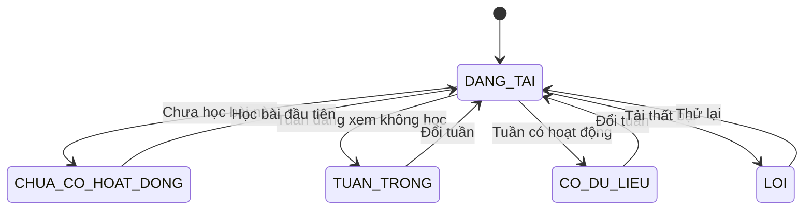
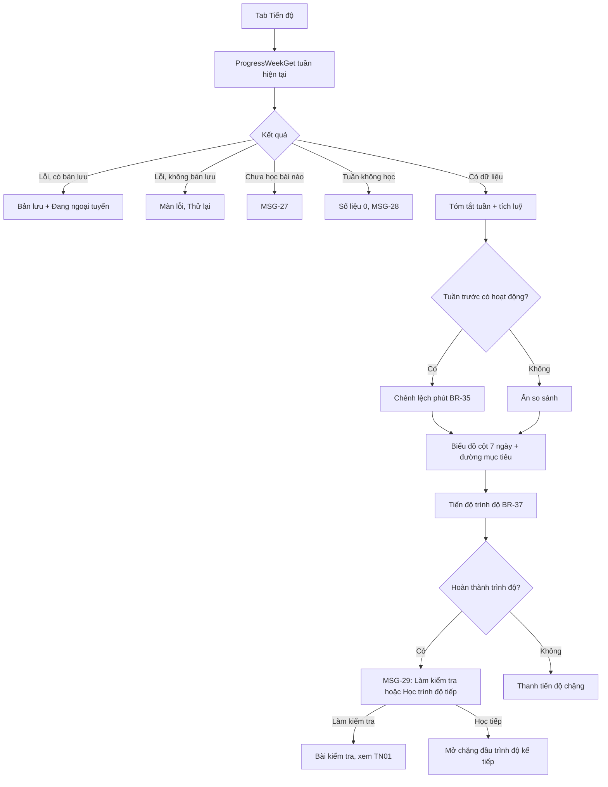
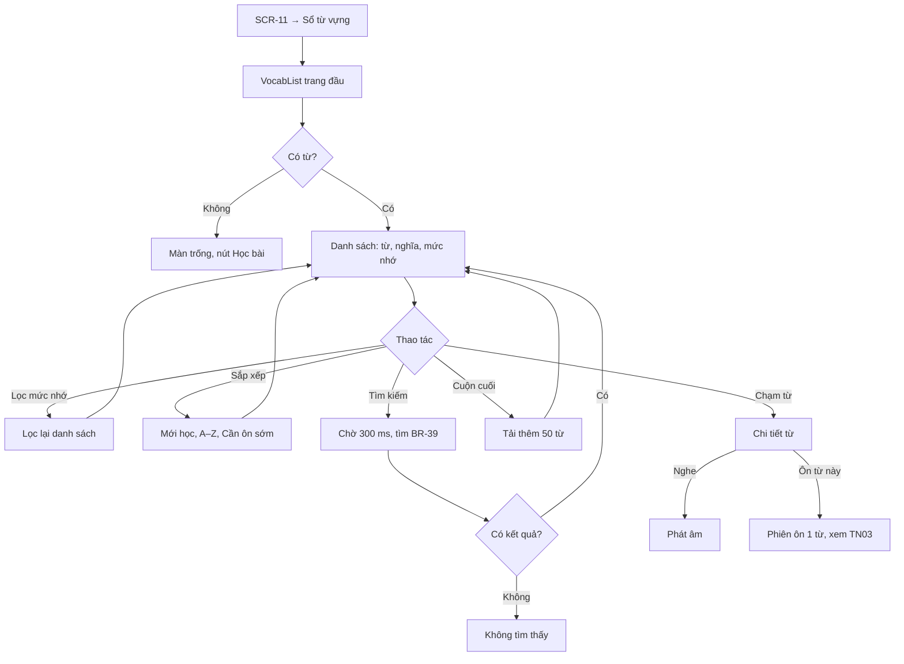
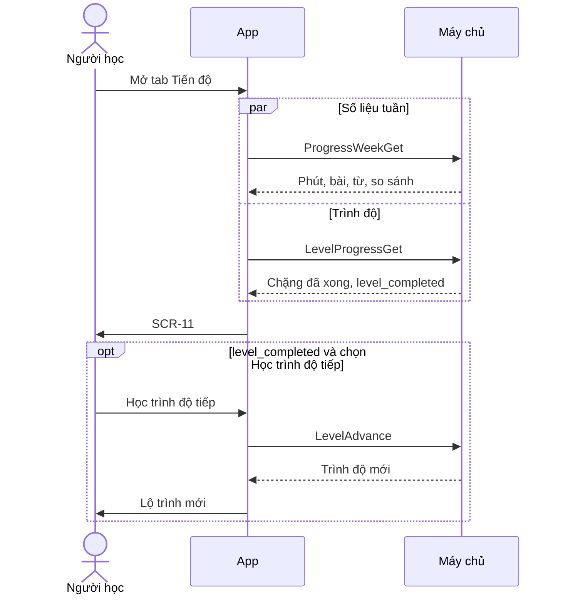

> **Mã:** DE03-TN04-SRS · **Trạng thái:** nháp · **Người viết:** Design (mock) · **PRD:** [PRD.md](PRD.md)

# UC-DE03-04 - Theo dõi tiến độ

> **Bản mock.** Giá trị `[giả định]` cần BA xác nhận. Thời gian học và mức ôn xem [SRS TN02](../TN02-hoc-bai/SRS.md), [SRS TN03](../TN03-on-tap-streak/SRS.md).

## 1. Tổng quan

| **Mục** | **Nội dung** |
| --- | --- |
| Mục tiêu | Người học xem công sức theo tuần, tiến độ trình độ và sổ từ vựng đã học |
| Actor | Người học · Hệ thống (app) · Máy chủ |
| Phạm vi | Màn Tiến độ, biểu đồ tuần, tiến độ trình độ, gợi ý lên trình độ, sổ từ vựng, chi tiết từ |
| Ngoài phạm vi | Thống kê theo kỹ năng, so sánh với người khác, xuất sổ từ |
| Nền tảng | App iOS / Android `[giả định]` |

## 2. User Story

| **ID** | **As a** | **I want** | **So that** |
| --- | --- | --- | --- |
| US-16 | Người học | Xem phút học, bài, từ trong tuần | Biết mình có đều đặn không |
| US-17 | Người học | So tuần này với tuần trước | Thấy xu hướng |
| US-18 | Người học | Biết còn bao xa tới trình độ tiếp theo | Có mục tiêu trung hạn |
| US-19 | Người học | Xem, tìm từ đã học | Tra lại và ôn khi cần |

## 3. Business Rules

| **Mã** | **Quy tắc** |
| --- | --- |
| BR-33 | **Tuần** từ thứ Hai 00:00 đến Chủ Nhật 23:59 theo múi giờ đã lưu (BR-32). Mặc định tuần hiện tại; xem lùi tới tuần có hoạt động đầu tiên |
| BR-34 | **Số liệu tuần** lấy từ DailyProgress (BR-27): tổng phút, số bài hoàn thành (kể cả học lại), số từ mới học trong tuần, số từ chuyển "Đã thuộc" trong tuần. **Tích luỹ**: tổng từ trước tới nay |
| BR-35 | **So tuần trước**: chênh lệch phút = tuần này − tuần trước. Tuần hiện tại so với cả tuần trước, kèm ghi chú "Tuần chưa kết thúc". Tuần trước không có hoạt động → không so |
| BR-36 | **Mức nhớ hiển thị** từ mức ôn (BR-23): mức 0–1 "Mới học", 2–4 "Đang nhớ", 5–6 chưa `mastered` "Nhớ tốt", `mastered` "Đã thuộc"; từ `known` hiện "Đã biết" (tự đánh dấu, không ôn). Từ lên mức 6 nhưng chưa trả lời đúng ở mức 6 (BR-24) vẫn là "Nhớ tốt" |
| BR-37 | **Tiến độ trình độ** = chặng `DA_HOAN_THANH` / tổng chặng của trình độ hiện tại. Chặng hoàn thành khi mọi bài trong chặng `DA_HOAN_THANH` |
| BR-38 | **Hoàn thành trình độ**: hiện gợi ý (MSG-29) với 2 lựa chọn: làm bài kiểm tra (bỏ qua giới hạn 30 ngày của BR-10) hoặc học tiếp trình độ kế tiếp. B2 là trình độ cao nhất ở MVP |
| BR-39 | **Sổ từ**: mọi từ có ReviewItem; mỗi từ có nút "Đánh dấu đã biết" / "Bỏ đánh dấu" (TN03 BR-23); mặc định sắp mới học trước; sắp xếp khác: A–Z, cần ôn sớm nhất. Tìm theo từ hoặc nghĩa, bỏ dấu, không phân biệt hoa thường; tải 50 từ mỗi lần `[giả định]` |

## 4. Trạng thái

### 4.1 Trạng thái màn Tiến độ

| **Trạng thái** | **Hiển thị** |
| --- | --- |
| `CHUA_CO_HOAT_DONG` | MSG-27 + nút "Học bài đầu tiên" |
| `TUAN_TRONG` | Số liệu bằng 0, biểu đồ trống, MSG-28 |
| `CO_DU_LIEU` | Tóm tắt, biểu đồ, tiến độ trình độ |
| `LOI` | Hiện số liệu đã lưu gần nhất nếu có, kèm "Đang ngoại tuyến"; không có thì màn lỗi + Thử lại |

### 4.2 Mức nhớ của từ (hiển thị)

`MOI_HOC` → `DANG_NHO` → `NHO_TOT` → `DA_THUOC`; trả lời sai khi ôn → về `MOI_HOC` (theo BR-24).

## 5. Use Case

### UC-09 Xem tiến độ

| **Mục** | **Nội dung** |
| --- | --- |
| Tiền điều kiện | Hồ sơ có trình độ |
| Hậu điều kiện | Người học thấy số liệu tuần và tiến độ trình độ |

**Luồng chính**

| **Bước** | **Actor** | **Mô tả** |
| --- | --- | --- |
| 1 | Người học | Mở tab Tiến độ |
| 2 | Hệ thống | Tải số liệu tuần hiện tại (\[ProgressWeekGet\]) và tiến độ trình độ (\[LevelProgressGet\]) |
| 3 | Hệ thống | Hiện **SCR-11**: tóm tắt (BR-34), so sánh (BR-35), biểu đồ, tiến độ trình độ (BR-37) |
| 4 | Người học | Chuyển tuần, chạm cột ngày để xem số phút |

**Luồng thay thế**

| **Mã** | **Điều kiện** | **Xử lý** |
| --- | --- | --- |
| A1 | Chưa học bài nào | MSG-27 |
| A2 | Tuần không có hoạt động | MSG-28 |
| A3 | Hoàn thành trình độ | MSG-29 (BR-38) |
| A4 | Trình độ B2 đã hoàn thành | MSG-30, không gợi ý lên trình độ |
| A5 | Mất mạng | Hiện bản lưu gần nhất kèm ghi chú |

### UC-10 Xem sổ từ vựng

| **Mục** | **Nội dung** |
| --- | --- |
| Tiền điều kiện | Không có |
| Hậu điều kiện | Người học tìm được từ cần xem; có thể ôn ngay |

**Luồng chính**

| **Bước** | **Actor** | **Mô tả** |
| --- | --- | --- |
| 1 | Người học | Chạm "Sổ từ vựng" ở **SCR-11** |
| 2 | Hệ thống | Tải trang đầu (\[VocabList\]), mở **SCR-12** |
| 3 | Người học | Lọc, sắp xếp, tìm kiếm |
| 4 | Người học | Chạm một từ |
| 5 | Hệ thống | Mở chi tiết từ (\[VocabDetail\]) |
| 6 | Người học | Bấm "Ôn từ này" → phiên ôn 1 từ (SRS TN03, UC-06 A3) |

## 6. Điểm vào

| **Điểm vào** | **Dẫn tới** | **Ghi chú** |
| --- | --- | --- |
| Tab Tiến độ | UC-09, **SCR-11** | |
| Nút "Sổ từ vựng" ở **SCR-11** | UC-10, **SCR-12** | |
| Ô "Từ mới" ở **SCR-07** | **SCR-12** lọc từ vừa học | `[giả định]` |
| Hồ sơ → Trình độ | Phần tiến độ trình độ ở **SCR-11** | |

## 7. Mô tả màn hình

### SCR-11 Tiến độ

| **#** | **Thành phần** | **Loại** | **Hành vi** |
| --- | --- | --- | --- |
| 1 | Chọn tuần | Header | "{dd/mm} – {dd/mm}"; nút trước, sau; nút sau disabled ở tuần hiện tại |
| 2 | Tóm tắt | 4 ô | Phút học, Bài hoàn thành, Từ mới, Từ đã thuộc; dòng phụ là tổng tích luỹ |
| 3 | So tuần trước | Text | "▲ / ▼ {n} phút so với tuần trước"; tuần hiện tại thêm "Tuần chưa kết thúc" |
| 4 | Biểu đồ tuần | Bar chart | 7 cột T2–CN; đường mục tiêu ngày; cột đạt mục tiêu có biểu tượng; chạm cột hiện "{thứ}: {n} phút" |
| 5 | Tiến độ trình độ | Card | "{A1–B2} · {x}/{y} chặng", thanh tiến độ; hoàn thành → MSG-29 |
| 6 | Sổ từ vựng | Card link | "{n} từ đã học · {m} từ đã thuộc" → **SCR-12** |
| 7 | Màn trống | Empty state | Theo mục 4.1 |

### SCR-12 Sổ từ vựng

| **#** | **Thành phần** | **Loại** | **Hành vi** |
| --- | --- | --- | --- |
| 1 | Ô tìm kiếm | Text | Placeholder "Tìm từ hoặc nghĩa" |
| 2 | Lọc mức nhớ | Chips | Tất cả, Mới học, Đang nhớ, Nhớ tốt, Đã thuộc, Đã biết; mỗi chip kèm số lượng |
| 3 | Sắp xếp | Menu | Mới học trước (mặc định), A–Z, Cần ôn sớm nhất |
| 4 | Dòng từ | List item | Từ, nghĩa ngắn, nhãn mức nhớ, nút nghe |
| 5 | Chi tiết từ | Bottom sheet | Từ, phiên âm, nút nghe, nghĩa, ví dụ, "Học ở bài: {tên bài}", mức nhớ, "Ôn tiếp: {ngày}", nút "Ôn từ này", nút "Đánh dấu đã biết" / "Bỏ đánh dấu" (BR-39) |
| 6 | Màn trống | Empty state | "Từ bạn học sẽ được lưu ở đây. \[Học bài\]"; tìm không ra: "Không tìm thấy từ nào cho '{từ khoá}'" |

## 8. API

| **API** | **Request chính** | **Response chính** | **Timeout / retry** `[giả định]` |
| --- | --- | --- | --- |
| \[ProgressWeekGet\] | profile_id, week_start | Phút mỗi ngày, mục tiêu ngày, bài hoàn thành, từ mới, từ đã thuộc, so tuần trước, tích luỹ | 5s / 1 lần; cache |
| \[LevelProgressGet\] | profile_id | level, chặng đã xong, tổng chặng, level_completed | 5s / 1 lần |
| \[VocabList\] | profile_id, filter, sort, keyword, cursor | Danh sách từ, mức nhớ, cursor tiếp | 5s / 1 lần |
| \[VocabDetail\] | word_id | Từ, phiên âm, âm thanh, nghĩa, ví dụ, bài học, mức, đến hạn, known | 5s / 1 lần |
| \[VocabMarkKnown\] | word_id, known | ReviewItem cập nhật | 5s / 2 lần; theo TN03 BR-23 |
| \[LevelAdvance\] | profile_id | Trình độ mới, chặng mở khoá | 5s / 2 lần |

**Map lỗi → thông báo**

| **Nhóm lỗi** | **Message** |
| --- | --- |
| Không tải được tiến độ, sổ từ (mất mạng, máy chủ lỗi) | Trạng thái `LOI` ở mục 4.1: màn lỗi kèm nút Thử lại |
| Chưa có dữ liệu học | MSG-27 |
| Tuần đang xem không có hoạt động | MSG-28 |
| Chưa đủ điều kiện lên trình độ | Ẩn nút lên trình độ; không báo lỗi |

## 9. Danh sách thông báo

| **ID** | **Nơi hiện** | **Nội dung (VI)** |
| --- | --- | --- |
| MSG-27 | **SCR-11** | Tiến độ của bạn sẽ hiện ở đây sau bài học đầu tiên. \[Học bài đầu tiên\] |
| MSG-28 | **SCR-11** | Tuần này bạn chưa học. Chỉ cần {mục tiêu} phút hôm nay để bắt đầu lại |
| MSG-29 | Card **SCR-11** | Bạn đã hoàn thành {trình độ}! \[Làm bài kiểm tra\] \[Học {trình độ tiếp}\] |
| MSG-30 | Card **SCR-11** | Bạn đã hoàn thành toàn bộ lộ trình hiện có. Tiếp tục ôn tập để giữ vốn từ nhé |

## 10. Yêu cầu phi chức năng

| **Mục** | **Yêu cầu** `[giả định]` |
| --- | --- |
| Hiệu năng | **SCR-11** hiện ≤ 1,5 giây; tìm trong sổ từ ≤ 500 ms với 5.000 từ |
| Nhất quán | Phút học ở mọi màn lấy từ cùng một nguồn (DailyProgress) |
| Offline | Hiện số liệu và sổ từ đã lưu gần nhất khi mất mạng |
| Bảo mật | Tiến độ và sổ từ chỉ người học thấy; API chỉ trả dữ liệu của tài khoản đang đăng nhập |
| Log / audit | Mỗi lần lên trình độ: trình độ cũ, mới, thời điểm; lỗi tải dữ liệu kèm mã lỗi |
| Tracking | Mở Tiến độ, đổi tuần, chạm cột, mở sổ từ, lọc, tìm (có / không kết quả), xem chi tiết từ, ôn từ này, chọn lên trình độ |
| Accessibility | Biểu đồ có bản thay thế dạng danh sách "{thứ}: {n} phút"; mức nhớ có nhãn chữ; tăng giảm có chữ kèm mũi tên |
